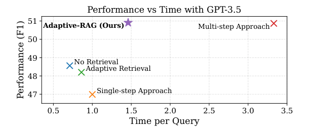
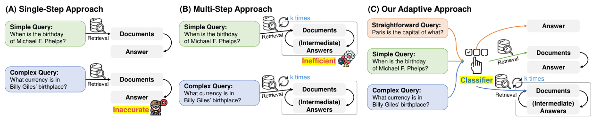
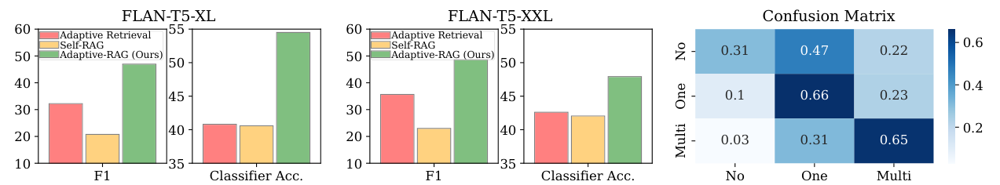

### Перевод статьи

**Adaptive-RAG: обучение адаптации больших языковых моделей, дополненных поиском, к сложности вопроса**

***Авторы**: Jeong S., Baek J., Cho S., Hwang S. J., Park J. C.[^1] (2024)*

*Школа вычислительной техники, Высшая школа искусственного интеллекта, Корейский передовой институт науки и технологий (KAIST)*

***Издание:** Proceedings of the 2024 Conference of the North American Chapter of the Association for Computational Linguistics: Human Language Technologies (NAACL 2024), том 1: Long Papers, с. 7036–7050. Перевод выполнен по препринту arXiv:2403.14403v2.*

**Аннотация (Abstract)**

Большие языковые модели (Large Language Models, LLM), дополненные поиском, — то есть модели, в которые встраиваются непараметрические знания из внешних баз знаний, — зарекомендовали себя как перспективный способ повысить точность ответов в ряде задач, в частности в задаче ответа на вопросы (Question Answering, QA). Однако существующие подходы к обработке запросов разной сложности либо тратят лишние вычислительные ресурсы на простые запросы, либо не справляются со сложными многошаговыми запросами, хотя запросы пользователей далеко не всегда укладываются только в одну из этих двух категорий. В данной работе предлагается новый адаптивный фреймворк для ответов на вопросы, который динамически выбирает для LLM (в том числе дополненных поиском) наиболее подходящую стратегию — от самой простой до самой сложной — в зависимости от сложности запроса. Выбор стратегии выполняет классификатор — языковая модель меньшего размера, обученная предсказывать уровень сложности поступающих запросов. Метки для её обучения собираются автоматически: по фактическим результатам предсказаний моделей и по индуктивным смещениям, присущим наборам данных. Такой подход представляет собой сбалансированную стратегию, которая в зависимости от сложности запроса плавно переключается между итеративными и одношаговыми LLM с поиском, а также методами без поиска. Модель проверена на ряде наборов данных для ответов на вопросы в открытой предметной области, охватывающих запросы разной сложности. Показано, что по сравнению с релевантными базовыми методами, включая методы адаптивного поиска, она повышает общую эффективность и точность вопросно-ответных систем. Код доступен по адресу: <https://github.com/starsuzi/Adaptive-RAG>.

**1. Введение (Introduction)**

*Рис. 1. Качество ответов на вопросы (F1) и эффективность (время на запрос) различных подходов к генерации, дополненной поиском. В качестве базовой LLM используется GPT-3.5-Turbo-Instruct.*

Современные большие языковые модели (LLM) (Brown et al., 2020; OpenAI, 2023; Touvron et al., 2023; Anil et al., 2023) показывают высокие результаты в самых разных задачах, включая ответы на вопросы (QA) (Yang et al., 2018; Kwiatkowski et al., 2019). Тем не менее они по-прежнему порождают фактически неверные ответы, поскольку их знания хранятся исключительно в параметрической памяти (Kasai et al., 2022; Mallen et al., 2023). Вместе с тем запомнить все знания о мире, которые к тому же постоянно меняются, по-видимому, невозможно. Для решения этой проблемы всё больше внимания уделяется LLM, дополненным поиском (Borgeaud et al., 2022; Izacard et al., 2023; Shi et al., 2023), — моделям, получающим непараметрические знания через дополнительные поисковые модули. Такие модели обращаются к базе знаний — обширному хранилищу информации по разным предметным областям и дисциплинам, — извлекают из неё сведения, относящиеся к входным данным, и передают их LLM. Это позволяет модели давать точные ответы и учитывать актуальное состояние знаний о мире.

*Рис. 2. Концептуальное сравнение подходов к ответам на вопросы на основе LLM, дополненных поиском. (A) Одношаговый подход в ответ на запрос извлекает релевантные документы, а затем генерирует ответ. Однако для сложных запросов, требующих многошаговых рассуждений, этого может оказаться недостаточно. (B) Многошаговый подход итеративно извлекает документы и генерирует промежуточные ответы. Он обладает большими возможностями, но крайне неэффективен для простых запросов, поскольку требует многократных обращений и к LLM, и к ретриверам (поисковым модулям). (C) Предлагаемый адаптивный подход выбирает наиболее подходящую стратегию для LLM с поиском — итеративную, одношаговую или даже без поиска — в зависимости от сложности запроса, которую определяет классификатор.*

Одно из наиболее заметных применений LLM, дополненных поиском, — задачи ответа на вопросы, цель которых состоит в том, чтобы давать правильные ответы на запросы пользователей, в том числе на запросы высокой сложности. Ранние работы по LLM с поиском были сосредоточены прежде всего на однопереходных (single-hop) запросах (Lazaridou et al., 2022; Ram et al., 2023), ответ на которые, как правило, содержится в одном документе. Соответственно, такой подход предполагает извлечение по запросу релевантного документа и последующую передачу этой информации вопросно-ответной модели для формирования ответа. Однако, в отличие от однопереходных вопросов, некоторые запросы требуют связать и обобщить сведения из нескольких документов, и ответить на них за один шаг «поиск — ответ» зачастую невозможно. Пример такого запроса: «Когда люди, захватившие Малакофф, пришли в регион, где расположен Филипсбург?» (‘When did the people who captured Malakoff come to the region where Philipsburg is located?’); для ответа на него требуются четыре шага рассуждения. Поэтому для эффективной обработки подобных сложных запросов в последних исследованиях основное внимание уделяется многошаговым ответам на вопросы с многоступенчатыми рассуждениями. Такие методы многократно и итеративно обращаются к LLM и к ретриверам (Press et al., 2023; Trivedi et al., 2023), что сопряжено со значительными вычислительными затратами.

Однако стоит задуматься: действительно ли в реальных условиях все запросы пользователей сложны? Напротив, пользователи часто задают простые и прямолинейные вопросы и лишь изредка — сложные. Например, запрос «Столицей чего является Париж?» (‘Paris is the capital of what?’), вероятно, будет встречаться чаще, чем упомянутый выше многошаговый запрос, и на такой более простой запрос LLM способны ответить сами, без обращения к внешним знаниям. Иными словами, многошаговый подход к ответам на вопросы может порождать излишние вычислительные затраты на простых запросах, хотя для сложных запросов он необходим (см. рис. 2 (A)). С другой стороны, для сложных запросов стратегии с одношаговым поиском или вовсе без поиска во многом недостаточны (рис. 2 (B)). Это указывает на необходимость адаптивной вопросно-ответной системы, которая способна динамически менять стратегию работы LLM с поиском в зависимости от сложности запроса. Некоторые современные подходы умеют делать это на основе частоты упоминания сущностей в запросах (Mallen et al., 2023) или на основе выходных данных моделей при многошаговых ответах на вопросы (Trivedi et al., 2023), однако они всё ещё неоптимальны: первые чрезмерно упрощены и не учитывают многопереходные (multi-hop) запросы, вторые же излишне сложны и завершают поиск ответа лишь после нескольких циклов обращения к модулям.

Учитывая разнообразие уровней сложности реальных запросов, мы полагаем, что прежние универсальные подходы, построенные по принципу «одно решение для всех», не способны охватить все такие запросы. Вместо этого предлагается выбирать наиболее подходящую стратегию из ряда LLM (в том числе дополненных поиском), каждая из которых соответствует определённому уровню сложности входного запроса. Ключевой шаг этого процесса — предварительное определение сложности запроса, от которого зависит выбор наиболее подходящей для него модели. В данной работе этот шаг выполняет новый классификатор — модель меньшего размера, обученная предсказывать уровень сложности поступающих запросов (см. рис. 2 (C)). Обучающие данные для классификатора собираются автоматически, без ручной разметки. Для этого используются результаты предсказаний моделей (т. е. сведения о том, какие модели правильно отвечают на какие запросы), а также индуктивные смещения, присущие существующим наборам данных (т. е. то, что примеры в наборах данных изначально рассчитаны либо на одношаговые, либо на многошаговые сценарии ответа на вопросы). Предложенный метод служит надёжным промежуточным решением между итеративными методами дополнения LLM для сложных запросов, одношаговыми методами для более простых запросов и даже методами без поиска для самых прямолинейных запросов, на которые LLM способны ответить сами. Благодаря этому, как показано на рис. 1, существенно повышаются общая эффективность и точность. Предложенный фреймворк назван адаптивной генерацией, дополненной поиском (Adaptive Retrieval-Augmented Generation, Adaptive-RAG).

Adaptive-RAG проверен на эталонных наборах данных для ответов на вопросы в открытой предметной области, которые охватывают широкий диапазон сложности запросов — от однопереходных (Rajpurkar et al., 2016; Joshi et al., 2017; Kwiatkowski et al., 2019) до многопереходных (Yang et al., 2018; Ho et al., 2020; Trivedi et al., 2022b). Результаты экспериментов показывают, что по сравнению с прежними адаптивными стратегиями предложенный подход существенно повышает общую точность и эффективность на нескольких LLM, в том числе на GPT-3.5 (Brown et al., 2020) и моделях серии FLAN-T5 (Chung et al., 2022).

Вклад и основные результаты работы состоят в следующем:

- рассмотрен реалистичный сценарий, в котором запросы различаются по сложности, и установлено, что существующие подходы к генерации, дополненной поиском, оказываются либо чрезмерно простыми, либо чрезмерно сложными;
- LLM, дополненные поиском, адаптированы к сложности запроса, которую оценивает классификатор, что позволяет применять к каждому запросу наиболее подходящий для него подход;
- показано, что Adaptive-RAG обладает высокой результативностью и эффективностью и обеспечивает баланс между сложностью и простотой при обработке разнородных запросов.

**2. Обзор родственных работ (Related Work)**

***Ответы на вопросы в открытой предметной области (Open-domain QA).*** Ответы на вопросы в открытой предметной области — это задача точного ответа на запрос, при которой система находит относящиеся к запросу документы, а затем интерпретирует их, чтобы сформировать ответ (Chen et al., 2017; Zhu et al., 2021). Соответственно, такие системы, как правило, состоят из двух модулей: ретривера (Karpukhin et al., 2020; Xiong et al., 2021) и модуля чтения (reader) (Yang et al., 2019; Izacard and Grave, 2021; Jeong et al., 2023). С появлением LLM, которые благодаря миллиардам параметров обладают развитыми способностями к рассуждению (Wei et al., 2022a), синергия LLM и ретриверов привела к значительному прогрессу (Lazaridou et al., 2022; Ram et al., 2023). В частности, показано, что такая интеграция повышает качество ответов на вопросы в открытой предметной области: она смягчает проблему галлюцинаций LLM за счёт усиления способностей модуля чтения к рассуждению, а также за счёт использования извлечённых внешних документов (Cho et al., 2023). Однако, несмотря на эти достижения в области однопереходных LLM с поиском, сложность некоторых запросов требует более сложной стратегии.

***Многопереходные ответы на вопросы (Multi-hop QA).*** Многопереходные ответы на вопросы — это расширение традиционной задачи ответа на вопросы в открытой предметной области, при котором для ответа на более сложные запросы система должна всесторонне собирать информацию из нескольких документов (часто итеративно) и увязывать её с контекстом (Trivedi et al., 2022a; Yang et al., 2018). В этой области, как правило, применяется подход с итеративным обращением и к LLM, и к поисковому модулю. В частности, Khattab et al. (2022), Press et al. (2023), Pereira et al. (2023) и Khot et al. (2023) предложили сначала разбивать многопереходные запросы на более простые однопереходные, затем многократно обращаться к LLM и ретриверу для решения этих подзапросов и объединять полученные решения в полный ответ. В отличие от такого подхода, основанного на декомпозиции, в других недавних исследованиях, например у Yao et al. (2023) и Trivedi et al. (2023), изучалось чередование поиска документов с рассуждениями по цепочке мыслей (Chain-of-Thought) (Wei et al., 2022b) — методом, при котором генерируется логическая последовательность рассуждений. Этот процесс повторяется до тех пор, пока цепочка рассуждений не приведёт к ответу. Кроме того, Jiang et al. (2023) предложили подход, при котором новые документы извлекаются повторно, если токены в сгенерированных предложениях имеют низкую уверенность. Однако в перечисленных методах не учитывается, что в реальных условиях запросы сильно различаются по сложности. Поэтому итеративно обращаться к LLM и ретриверам для каждого запроса крайне неэффективно: многим запросам достаточно одного шага поиска или даже одной лишь LLM.

***Адаптивный поиск (Adaptive Retrieval).*** Для обработки запросов разной сложности стратегия адаптивного поиска динамически решает, извлекать документы или нет, исходя из сложности каждого запроса. В этом русле Mallen et al. (2023) предложили определять уровень сложности запроса по частоте упоминания входящих в него сущностей и обращаться к поисковым модулям только тогда, когда эта частота опускается ниже определённого порога. Однако такой подход сводится к бинарному решению о том, выполнять поиск или нет, и может оказаться недостаточным для более сложных запросов, требующих нескольких шагов рассуждения. Кроме того, Qi et al. (2021) предложили подход на основе традиционных языковых моделей типа BERT, который многократно выполняет фиксированный набор операций (поиск, чтение и переранжирование), пока не будет получен ответ на заданный запрос. Однако, в отличие от Adaptive-RAG, который заранее определяет сложность запроса и соответствующим образом адаптирует поведение любых готовых LLM, этот подход применяет одни и те же фиксированные операции к каждому запросу независимо от его сложности и, кроме того, требует дополнительного специального обучения языковых моделей. Одновременно с нашей работой Asai et al. (2024) предложили обучать сложную модель, которая динамически выполняет поиск, критически оценивает и генерирует текст. Тем не менее мы полагаем, что все перечисленные методы адаптивного поиска, опирающиеся на единственную модель, могут быть неоптимальными при обработке запросов разной сложности, поскольку для всех входных запросов они оказываются либо чрезмерно простыми, либо чрезмерно сложными. Это требует нового подхода, способного выбирать наиболее подходящую стратегию LLM с поиском с учётом сложности запроса.

**3. Метод (Method)**

В данном разделе описывается предлагаемый подход к адаптации LLM, дополненных поиском: сначала определяется сложность запроса, а затем для LLM с поиском выбирается наиболее подходящая стратегия.

**3.1. Предварительные сведения (Preliminaries)**

Начнём с предварительных сведений и формально опишем различные стратегии работы LLM, дополненных поиском.

***Ответы на вопросы без поиска (Non Retrieval for QA).*** Определим LLM как модель LLM, которая принимает на вход последовательность токенов ${\mathbf{x}} = {\lbrack{x_{1},x_{2},\ldots,x_{n}}\rbrack}$ и генерирует на выходе последовательность токенов ${\mathbf{y}} = {\lbrack{y_{1},y_{2},\ldots,y_{n}}\rbrack}$, что формально записывается как ${\mathbf{y}} = {\text{LLM}{({\mathbf{x}})}}$. Тогда в постановке задачи ответа на вопросы $\mathbf{x}$ и $\mathbf{y}$ — это соответственно входной запрос пользователя ($\mathbf{q}$) и сгенерированный LLM ответ ($\overline{\mathbf{a}}$): ${\mathbf{q}} = {\mathbf{x}}$ и $\overline{\mathbf{a}} = {\mathbf{y}}$. Соответственно, простейшую вопросно-ответную модель на основе LLM можно представить так: $\overline{\mathbf{a}} = {\text{LLM}{({\mathbf{q}})}}$. В идеале $\overline{\mathbf{a}}$ должен совпадать с действительным правильным ответом $\mathbf{a}$. Метод ответа на вопросы без поиска отличается высокой эффективностью и может быть достаточно перспективным для простых запросов, поскольку с ростом размера LLM растёт и объём знаний, которые модель способна хранить. Однако на запросах, требующих точных или актуальных знаний о конкретных людях, событиях или любых других предметах, выходящих за пределы внутренних знаний LLM, этот подход во многом несостоятелен.

***Одношаговый подход к ответам на вопросы (Single-step Approach for QA).*** Чтобы справиться с описанными ситуациями, в которых LLM не может ответить на запрос самостоятельно, можно использовать внешние знания $\mathbf{d}$, содержащие полезную для запроса информацию. Эти знания извлекаются из внешнего источника знаний $\mathcal{D}$ — например, энциклопедии (такой как Википедия), состоящей из миллионов документов. Чтобы получить такие $\mathbf{d}$ из $\mathcal{D}$, необходима специальная поисковая модель, которая возвращает документы в соответствии с их релевантностью заданному запросу. Этот процесс можно записать так: ${\mathbf{d}} = {\text{Retriever}{({\mathbf{q}},D)}}$, где Retriever — поисковая модель, а ${\mathbf{d}} \in \mathcal{D}$. В качестве поисковой модели можно использовать любой готовый ретривер (Robertson et al., 1994; Karpukhin et al., 2020).

После шага поиска имеется пара из запроса $\mathbf{q}$ и релевантных ему документов $\mathbf{d}$. Далее, чтобы дополнить LLM извлечёнными внешними знаниями, их можно включить во входные данные LLM: $\overline{\mathbf{a}} = {\text{LLM}{({\mathbf{q}},{\mathbf{d}})}}$. Так LLM получает доступ к внешней информации, содержащейся в $\mathbf{d}$. Эта информация восполняет контекст, которого недостаёт во внутренних знаниях LLM, и тем самым повышает точность и актуальность ответов LLM на вопросы.

***Многошаговый подход к ответам на вопросы (Multi-step Approach for QA).*** Хотя описанный одношаговый подход существенно превосходит подход без поиска для запросов $\mathbf{q}$, требующих внешних знаний, у него есть заметные ограничения, особенно при обработке сложных запросов, для которых нужно синтезировать информацию из нескольких исходных документов и проводить над ней рассуждения. Именно в таких случаях необходимы многошаговый подход и рассуждения при ответе на вопросы.

При многошаговом подходе LLM взаимодействует с ретривером (Retriever) в течение нескольких циклов и постепенно уточняет понимание запроса $\mathbf{q}$, пока не сформулирует итоговый ответ на основе сведений, накопленных за эти шаги. Процесс начинается с исходного запроса $\mathbf{q}$; на каждом шаге поиска $i$ из $\mathcal{D}$ извлекаются новые документы ${\mathbf{d}}_{i}$, которые затем включаются во входные данные LLM: ${\overline{\mathbf{a}}}_{i} = {\text{LLM}{({\mathbf{q}},{\mathbf{d}}_{i},{\mathbf{c}}_{i})}}$, где дополнительный контекст ${\mathbf{c}}_{i}$ может состоять из предыдущих документов и результатов $({\mathbf{d}}_{1},{\mathbf{d}}_{2},\ldots,{\mathbf{d}}_{i - 1},{\overline{\mathbf{a}}}_{1},{\overline{\mathbf{a}}}_{2},\ldots,{\overline{\mathbf{a}}}_{i - 1})$, а ${\mathbf{d}}_{i} = {\text{Retriever}{({\mathbf{q}},{\mathbf{c}}_{i},D)}}$[^2]. Такой итеративный многошаговый процесс позволяет LLM сформировать более полную и обширную основу для решения запросов и особенно хорошо подходит для сложных многопереходных запросов, ответ на которые зависит от взаимосвязанных фрагментов информации. Вместе с тем многошаговый подход может быть ресурсоёмким: многократные обращения к ретриверу и LLM влекут значительные вычислительные затраты.

**3.2. Adaptive-RAG: адаптивная генерация, дополненная поиском (Adaptive-RAG: Adaptive Retrieval-Augmented Generation)**

Перейдём к описанию предлагаемых адаптивных LLM, дополненных поиском. Они строятся на трёх стратегиях, описанных в предыдущем разделе, и выбирают наиболее подходящую из них в зависимости от сложности запроса.

***Адаптация LLM, дополненных поиском (Adapting Retrieval-Augmented LLMs).*** В реальных условиях запросы $\mathbf{q}$ пользователей имеют разный уровень сложности, поэтому каждый запрос требует собственной стратегии обработки. Иными словами, применение простейшего подхода без поиска $\text{LLM}{({\mathbf{q}})}$ к сложному запросу $\mathbf{q}$ было бы нерезультативным (рис. 2, A), и наоборот, применение более сложного многошагового подхода $\text{LLM}{({\mathbf{q}},{\mathbf{d}},{\mathbf{c}})}$ к простому $\mathbf{q}$ было бы неэффективным (рис. 2, B). Поэтому предлагаемый адаптивный фреймворк динамически подстраивает стратегию обработки запроса LLM с поиском: сложность каждого запроса определяется до того, как начинается поиск ответа. Важно, что такой фреймворк служит надёжным промежуточным решением и предлагает целый спектр вариантов: от простейшего подхода для самых прямолинейных запросов и одношагового подхода для запросов средней сложности до наиболее полного и тщательного подхода для сложных запросов. Кроме того, поскольку операции LLM и ретривера не зависят от поступающих на них входных данных, метод может беспрепятственно переключаться между запросами разной сложности, не меняя внутреннюю архитектуру или параметры модели при адаптации.

***Оценка сложности запроса (Query Complexity Assessment).*** Чтобы реализовать адаптивный фреймворк LLM с поиском на практике, необходимо определять сложность запроса. С этой целью предлагается построить классификатор сложности, который возвращает уровень сложности заданного запроса. Формально для запроса $\mathbf{q}$ классификатор записывается так: $o = {\text{Classifier}{({\mathbf{q}})}}$, где Classifier — языковая модель меньшего размера, обученная относить запрос к одному из трёх уровней сложности, а $o$ — соответствующая метка класса. В предложенной конструкции классификатора используются три метки: «A», «B» и «C». Метка «A» означает, что запрос $\mathbf{q}$ прост и на него может ответить сама $\text{LLM}{({\mathbf{q}})}$; «B» — что $\mathbf{q}$ имеет среднюю сложность и требует как минимум одношагового подхода $\text{LLM}{({\mathbf{q}},{\mathbf{d}})}$; «C» — что $\mathbf{q}$ сложен и требует наиболее развёрнутого решения $\text{LLM}{({\mathbf{q}},{\mathbf{d}},{\mathbf{c}})}$[^3].

***Стратегия обучения (Training Strategy).*** Остаётся обучить языковую модель меньшего размера, лежащую в основе классификатора, так, чтобы она точно предсказывала сложность $o$ заданного запроса $\mathbf{q}$. Однако размеченного набора данных с парами «запрос — сложность» не существует. Поэтому предлагается строить обучающий набор данных автоматически с помощью двух стратегий.

Во-первых, сложность запроса размечается по результатам трёх различных стратегий LLM с поиском, чтобы метка отражала то, что действительно требуется для ответа. Например, если правильный ответ генерирует уже простейший подход без поиска, соответствующему запросу присваивается метка «A». Если правильный ответ дают несколько моделей, приоритет отдаётся более простой. Иными словами, если одношаговый и многошаговый подходы дают одинаковый правильный ответ, а подход без поиска ошибается, запросу присваивается метка «B».

Однако у этой стратегии разметки есть ограничение: метки получают не все запросы, поскольку правильного ответа может не дать ни один из трёх подходов. С другой стороны, эталонные наборы данных уже могут содержать значимые индуктивные смещения относительно того, какие стратегии LLM с поиском лучше всего подходят для их запросов. Эти смещения обусловлены способом создания наборов: например, наборы данных, требующие последовательных рассуждений, как правило, предполагают многошаговый подход, а на запросы из наборов, где к каждому запросу размечен один документ, в идеале можно ответить одношаговым подходом. Поэтому запросам, оставшимся без метки после первого этапа разметки, присваивается метка «B», если они взяты из однопереходных наборов данных, и «C», если из многопереходных. Наконец, классификатор обучается на этих автоматически собранных парах «запрос — сложность»[^4] с функцией потерь перекрёстной энтропии. На этапе инференса сложность запроса (одна из меток {«A», «B», «C»}) определяется подачей запроса на вход классификатора: $o = {\text{Classifier}{({\mathbf{q}})}}$.

**4. Экспериментальная установка (Experimental Setups)**

В данном разделе описываются наборы данных, модели, метрики и детали реализации. Дополнительные сведения приведены в приложении A.

**4.1. Наборы данных (Datasets)**

Чтобы смоделировать реалистичный сценарий, в котором запросы различаются по сложности, однопереходные и многопереходные наборы данных для ответов на вопросы используются одновременно, в единой экспериментальной постановке.

*Таблица 1. Усреднённые результаты на совокупности эталонных наборов данных для ответов на вопросы в открытой предметной области, включающих однопереходные и многопереходные запросы, для различных LLM. Self-RAG\* обучена на другой базовой LLM — LLaMA2 (Touvron et al., 2023), поэтому результаты FLAN-T5-XL (3B) сравниваются с результатами Self-RAG на LLaMA2 (7B), а результаты остальных моделей — с результатами Self-RAG на LLaMA2 (13B). Для удобства сравнения наши результаты выделены полужирным. В переводе таблица для удобства чтения разбита на части по моделям.*

*(а) FLAN-T5-XL (3B)*

| **Тип** | **Метод** | EM | F1 | Acc | Шаги | Время |
|------------|--------------|-------|-------|-------|------|-------|
| **Простые** | **Без поиска** | 14,87 | 21,12 | 15,97 | 0,00 | 0,11 |
|  | **Одношаговый подход** | 34,83 | 44,31 | 38,87 | 1,00 | 1,00 |
| **Адаптивные** | **Adaptive Retrieval** | 23,87 | 32,24 | 26,73 | 0,50 | 0,56 |
|  | **Self-RAG\*** | 9,90 | 20,79 | 31,57 | 0,72 | 0,43 |
|  | **Adaptive-RAG (наш)** | **37,17** | **46,94** | **42,10** | **2,17** | **3,60** |
| **Сложные** | **Многошаговый подход** | 39,00 | 48,85 | 43,70 | 4,69 | 8,81 |
| **Оракул** | **Adaptive-RAG с оракулом** | 45,00 | 56,28 | 49,90 | 1,28 | 2,11 |

*(б) FLAN-T5-XXL (11B)*

| **Тип** | **Метод** | EM | F1 | Acc | Шаги | Время |
|------------|--------------|-------|-------|-------|------|-------|
| **Простые** | **Без поиска** | 17,83 | 25,14 | 19,33 | 0,00 | 0,08 |
|  | **Одношаговый подход** | 37,87 | 47,63 | 41,90 | 1,00 | 1,00 |
| **Адаптивные** | **Adaptive Retrieval** | 26,93 | 35,67 | 29,73 | 0,50 | 0,54 |
|  | **Self-RAG\*** | 10,87 | 22,98 | 34,13 | 0,74 | 0,23 |
|  | **Adaptive-RAG (наш)** | **38,90** | **48,62** | **43,77** | **1,35** | **2,00** |
| **Сложные** | **Многошаговый подход** | 40,13 | 50,09 | 45,20 | 2,13 | 3,80 |
| **Оракул** | **Adaptive-RAG с оракулом** | 47,17 | 58,60 | 52,20 | 0,84 | 1,10 |

*(в) GPT-3.5 (Turbo)*

| **Тип** | **Метод** | EM | F1 | Acc | Шаги | Время |
|------------|--------------|-------|-------|-------|------|-------|
| **Простые** | **Без поиска** | 35,77 | 48,56 | 44,27 | 0,00 | 0,71 |
|  | **Одношаговый подход** | 34,73 | 46,99 | 45,27 | 1,00 | 1,00 |
| **Адаптивные** | **Adaptive Retrieval** | 35,90 | 48,20 | 45,30 | 0,50 | 0,86 |
|  | **Self-RAG\*** | 10,87 | 22,98 | 34,13 | 0,74 | 1,50 |
|  | **Adaptive-RAG (наш)** | **37,97** | **50,91** | **48,97** | **1,03** | **1,46** |
| **Сложные** | **Многошаговый подход** | 38,13 | 50,87 | 49,70 | 2,81 | 3,33 |
| **Оракул** | **Adaptive-RAG с оракулом** | 47,70 | 62,80 | 58,57 | 0,50 | 1,03 |

***Однопереходные вопросы (Single-hop QA).*** Для более простых запросов используются три эталонных однопереходных набора данных, состоящих из запросов и связанных с ними документов, которые содержат ответы: 1) SQuAD v1.1 (Rajpurkar et al., 2016), 2) Natural Questions (Kwiatkowski et al., 2019) и 3) TriviaQA (Joshi et al., 2017).

***Многопереходные вопросы (Multi-hop QA).*** Для более сложных сценариев используются три эталонных многопереходных набора данных, требующих последовательных рассуждений над несколькими документами: 1) MuSiQue (Trivedi et al., 2022a), 2) HotpotQA (Yang et al., 2018) и 3) 2WikiMultiHopQA (Ho et al., 2020).

*Таблица 2. Результаты на каждом из наборов данных при использовании FLAN-T5-XL (3B) в качестве LLM. Наши результаты выделены полужирным. В переводе таблица для удобства чтения разбита на части по наборам данных.*

*(а) SQuAD (одношаговые данные)*

| **Тип** | **Метод** | EM | F1 | Acc | Шаги | Время |
|------------|--------------|-------|-------|-------|------|-------|
| **Простые** | **Без поиска** | 3,60 | 10,50 | 5,00 | 0,00 | 0,11 |
|  | **Одношаговый подход** | 27,80 | 39,30 | 34,00 | 1,00 | 1,00 |
| **Адаптивные** | **Adaptive Retrieval** | 13,40 | 23,10 | 17,60 | 0,50 | 0,55 |
|  | **Self-RAG\*** | 2,20 | 11,20 | 18,40 | 0,63 | 0,50 |
|  | **Adaptive-RAG (наш)** | **26,80** | **38,30** | **33,00** | **1,37** | **2,02** |
| **Сложные** | **Многошаговый подход** | 24,40 | 35,60 | 29,60 | 4,52 | 9,03 |
| **Оракул** | **Adaptive-RAG с оракулом** | 32,00 | 45,60 | 38,20 | 1,24 | 1,60 |

*(б) Natural Questions (одношаговые данные)*

| **Тип** | **Метод** | EM | F1 | Acc | Шаги | Время |
|------------|--------------|-------|-------|-------|------|-------|
| **Простые** | **Без поиска** | 14,20 | 19,00 | 15,60 | 0,00 | 0,13 |
|  | **Одношаговый подход** | 37,80 | 47,30 | 44,60 | 1,00 | 1,00 |
| **Адаптивные** | **Adaptive Retrieval** | 28,20 | 36,00 | 33,00 | 0,50 | 0,56 |
|  | **Self-RAG\*** | 31,40 | 39,00 | 33,60 | 0,63 | 0,17 |
|  | **Adaptive-RAG (наш)** | **37,80** | **47,30** | **44,60** | **1,00** | **1,00** |
| **Сложные** | **Многошаговый подход** | 38,60 | 47,80 | 44,20 | 5,04 | 10,18 |
| **Оракул** | **Adaptive-RAG с оракулом** | 47,40 | 57,10 | 53,60 | 1,10 | 1,55 |

*(в) TriviaQA (одношаговые данные)*

| **Тип** | **Метод** | EM | F1 | Acc | Шаги | Время |
|------------|--------------|-------|-------|-------|------|-------|
| **Простые** | **Без поиска** | 25,00 | 31,80 | 27,00 | 0,00 | 0,13 |
|  | **Одношаговый подход** | 53,60 | 62,40 | 60,20 | 1,00 | 1,00 |
| **Адаптивные** | **Adaptive Retrieval** | 38,40 | 46,90 | 42,60 | 0,50 | 0,56 |
|  | **Self-RAG\*** | 12,80 | 29,30 | 57,00 | 0,68 | 0,45 |
|  | **Adaptive-RAG (наш)** | **52,20** | **60,70** | **58,20** | **1,23** | **1,54** |
| **Сложные** | **Многошаговый подход** | 53,80 | 62,40 | 60,20 | 5,28 | 9,22 |
| **Оракул** | **Adaptive-RAG с оракулом** | 61,60 | 70,20 | 66,40 | 0,79 | 1,10 |

*(г) MuSiQue (многошаговые данные)*

| **Тип** | **Метод** | EM | F1 | Acc | Шаги | Время |
|------------|--------------|-------|-------|-------|------|-------|
| **Простые** | **Без поиска** | 2,40 | 10,70 | 3,20 | 0,00 | 0,11 |
|  | **Одношаговый подход** | 13,80 | 22,80 | 15,20 | 1,00 | 1,00 |
| **Адаптивные** | **Adaptive Retrieval** | 6,40 | 15,80 | 8,00 | 0,50 | 0,55 |
|  | **Self-RAG\*** | 1,60 | 8,10 | 12,00 | 0,73 | 0,51 |
|  | **Adaptive-RAG (наш)** | **23,60** | **31,80** | **26,00** | **3,22** | **6,61** |
| **Сложные** | **Многошаговый подход** | 23,00 | 31,90 | 25,80 | 3,60 | 7,58 |
| **Оракул** | **Adaptive-RAG с оракулом** | 24,80 | 38,50 | 27,00 | 1,98 | 3,99 |

*(д) HotpotQA (многошаговые данные)*

| **Тип** | **Метод** | EM | F1 | Acc | Шаги | Время |
|------------|--------------|-------|-------|-------|------|-------|
| **Простые** | **Без поиска** | 16,60 | 22,71 | 17,20 | 0,00 | 0,11 |
|  | **Одношаговый подход** | 34,40 | 46,15 | 36,40 | 1,00 | 1,00 |
| **Адаптивные** | **Adaptive Retrieval** | 23,60 | 32,22 | 25,00 | 0,50 | 0,55 |
|  | **Self-RAG\*** | 6,80 | 17,53 | 29,60 | 0,73 | 0,45 |
|  | **Adaptive-RAG (наш)** | **42,00** | **53,82** | **44,40** | **3,55** | **5,99** |
| **Сложные** | **Многошаговый подход** | 44,60 | 56,54 | 47,00 | 5,53 | 9,38 |
| **Оракул** | **Adaptive-RAG с оракулом** | 51,20 | 64,00 | 54,80 | 1,59 | 2,77 |

*(е) 2WikiMultiHopQA (многошаговые данные)*

| **Тип** | **Метод** | EM | F1 | Acc | Шаги | Время |
|------------|--------------|-------|-------|-------|------|-------|
| **Простые** | **Без поиска** | 27,40 | 32,04 | 27,80 | 0,00 | 0,10 |
|  | **Одношаговый подход** | 41,60 | 47,90 | 42,80 | 1,00 | 1,00 |
| **Адаптивные** | **Adaptive Retrieval** | 33,20 | 39,44 | 34,20 | 0,50 | 0,55 |
|  | **Self-RAG\*** | 4,60 | 19,59 | 38,80 | 0,93 | 0,49 |
|  | **Adaptive-RAG (наш)** | **40,60** | **49,75** | **46,40** | **2,63** | **4,68** |
| **Сложные** | **Многошаговый подход** | 49,60 | 58,85 | 55,40 | 4,17 | 7,37 |
| **Оракул** | **Adaptive-RAG с оракулом** | 53,00 | 62,30 | 59,40 | 1,01 | 1,69 |

*Рис. 3. Качество ответов на вопросы и точность оценки сложности запросов для различных адаптивных подходов к LLM с поиском на моделях FLAN-T5 XL (слева) и XXL (в центре). Для разметки сложности запросов используются «серебряные» данные, размеченные по результатам предсказаний моделей (см. разд. 3.2). Справа приведена матрица ошибок по трём меткам.*

**4.2. Модели (Models)**

Adaptive-RAG сравнивается с релевантными моделями, включая три стратегии LLM с поиском (разд. 3.1) и методы адаптивного поиска (Mallen et al., 2023; Asai et al., 2024). Все модели можно разделить на три категории: простые (Simple), адаптивные (Adaptive) и сложные (Complex). К простым относятся 1) метод без поиска (No Retrieval) и 2) методы на основе одношагового подхода (Single-step Approach). К адаптивным относятся 3) Adaptive Retrieval (Mallen et al., 2023), 4) Self-RAG (Asai et al., 2024) и предлагаемый 5) Adaptive-RAG: все они способны адаптивно выполнять поиск в зависимости от сложности вопроса. В качестве 6) многошагового подхода (Multi-step Approach) используется наиболее совершенный из современных методов (Trivedi et al., 2023), который для каждого запроса итеративно обращается и к ретриверу, и к LLM, применяя рассуждения по цепочке мыслей (Wei et al., 2022b). Модели из разных категорий напрямую несопоставимы. Тем не менее в идеальном случае адаптивные подходы должны быть результативнее простых и одновременно эффективнее сложного. Поэтому приводятся также результаты для идеального сценария — 7) Adaptive-RAG с оракулом (Adaptive-RAG w/ Oracle), в котором Adaptive-RAG использует классификатор-оракул.

**4.3. Метрики оценки (Evaluation Metrics)**

При оценке адаптивных моделей необходимо одновременно учитывать качество решения задачи и эффективность, а также компромисс между ними. Поэтому результаты приводятся по пяти метрикам: три из них измеряют результативность, две — эффективность. Для оценки результативности в соответствии со стандартным протоколом (Mallen et al., 2023; Baek et al., 2023; Asai et al., 2024) используются F1, точное совпадение (Exact Match, EM) и точность (Accuracy, Acc). F1 учитывает число слов, общих для предсказанного и эталонного ответов, EM показывает, совпадают ли эти ответы, а Acc — содержит ли предсказанный ответ эталонный. Для оценки эффективности измеряется число шагов «поиск — генерация» и среднее время ответа на один запрос относительно одношагового подхода.

**4.4. Детали реализации (Implementation Details)**

Для корректного сравнения во всех моделях, вслед за Mallen et al. (2023) и Trivedi et al. (2023), используется один и тот же ретривер — разреженная поисковая модель на основе терминов BM25 (Robertson et al., 1994). Внешний корпус документов зависит от типа набора данных: для однопереходных наборов используется корпус Википедии, предобработанный Karpukhin et al. (2020), для многопереходных — корпус, предобработанный Trivedi et al. (2023). Ответы генерируют модели серии FLAN-T5 (Chung et al., 2022) размеров XL (3 млрд параметров) и XXL (11 млрд параметров), а также модель GPT-3.5 (gpt-3.5-turbo-instruct). LLM с поиском построены по деталям реализации из работы Trivedi et al. (2023), включая входные промпты, инструкции и число тестовых примеров для оценки (например, 500 примеров на набор данных). В качестве классификатора сложности запросов в Adaptive-RAG обучается модель T5-Large (Raffel et al., 2020). Для классификатора выбирается эпоха с наилучшим качеством на валидационной выборке в пределах 100 итераций обучения; скорость обучения составляет $3 \cdot 10^{-5}$, оптимизатор — AdamW (Loshchilov and Hutter, 2019). Для обучающих данных классификатора из 6 наборов данных отбирается и размечается по их индуктивному смещению 400 запросов (однопереходные — для одношагового подхода, многопереходные — для многошагового). Кроме того, используются результаты предсказаний трёх различных стратегий на 400 запросах, отобранных из каждого набора данных. Запросы, использованные для обучения классификатора, не пересекаются с тестовыми запросами для оценки ответов на вопросы.

**5. Результаты экспериментов и их анализ (Experimental Results and Analyses)**

В данном разделе приводятся общие результаты экспериментов и подробный анализ предложенного метода.

***Основные результаты (Main Results).*** Прежде всего, в табл. 1 приведены основные результаты, усреднённые по всем рассмотренным наборам данных. Они подтверждают гипотезу о том, что простые стратегии LLM с поиском менее результативны, чем сложная стратегия, тогда как сложная стратегия обходится значительно дороже простых. Более детальные результаты FLAN-T5-XL на каждом из однопереходных и многопереходных наборов данных приведены в табл. 2 (результаты для других LLM — в табл. 7 и табл. 8 приложения); они согласуются с результатами табл. 1.

Однако в реальных условиях не все пользователи задают запросы одинаковой сложности, и это подчёркивает необходимость адаптивных стратегий. Среди адаптивных стратегий Adaptive-RAG заметно результативнее конкурентов (табл. 1). Это говорит о том, что ограничиваться решением, выполнять поиск или нет, неоптимально. Кроме того, как видно из табл. 2, такие простые адаптивные стратегии особенно плохо справляются со сложными запросами из многопереходных наборов данных, которые требуют агрегировать информацию из нескольких документов и рассуждать над ней. Предлагаемый же подход реализует более тонкую стратегию обработки запросов за счёт дополнительного итеративного модуля для сложных запросов. Кроме того, в реалистичной постановке следует учитывать не только результативность, но и эффективность. Как видно из табл. 1, предложенная адаптивная стратегия значительно эффективнее сложной многошаговой стратегии для моделей всех размеров. Это важно в эпоху LLM, когда стоимость обращения к ним — критический фактор для практического применения и масштабируемости. Наконец, чтобы оценить верхнюю границу возможностей Adaptive-RAG, приводятся его результаты с классификатором-оракулом, который классифицирует запросы безошибочно. Как видно из табл. 1 и табл. 2, в этом случае достигается наилучшее качество при значительно большей эффективности, чем у Adaptive-RAG без классификатора-оракула. Эти результаты подтверждают обоснованность и значимость адаптации стратегий LLM с поиском к сложности запроса и указывают на целесообразность разработки более совершенных классификаторов для достижения оптимального качества.

***Качество классификатора (Classifier Performance).*** Чтобы понять, как работает предложенный классификатор, проанализируем его качество для разных меток сложности. Как видно на рис. 3 (слева и в центре), точность классификации у Adaptive-RAG выше, чем у других базовых методов адаптивного поиска, что повышает общее качество ответов на вопросы. Иными словами, этот результат показывает, что Adaptive-RAG точнее классифицирует уровни сложности с различной степенью детализации: без поиска, с однократным поиском и с многократным поиском. Помимо доли истинно положительных результатов классификатора, усреднённой по трём меткам (рис. 3, слева и в центре), на рис. 3 (справа) приведена его матрица ошибок. Она выявляет ряд заметных тенденций: метку «C (Multi)» классификатор иногда ошибочно принимает за «B (One)» (около 31%), а «B (One)» — за «C (Multi)» (около 23%); «A (No)» часто ошибочно классифицируется как «B (One)» (около 47%) и реже — как «C (Multi)» (около 22%). Хотя общие результаты на рис. 3 показывают, что классификатор успешно различает три метки, его дальнейшее совершенствование с учётом таких ошибок классификации — перспективное направление будущих исследований.

***Анализ эффективности классификатора (Analyses on Efficiency for Classifier).*** В табл. 1 приведено относительное затраченное время для каждой из трёх стратегий RAG. В табл. 3 дополнительно приведены абсолютное время обработки одного запроса в Adaptive-RAG и распределение меток, предсказанных классификатором сложности запросов. Как и относительное время в табл. 1, абсолютное время в табл. 3 показывает, что выявление простых или прямолинейных запросов позволяет существенно повысить эффективность.

*Таблица 3. Абсолютное время обработки одного запроса и доля меток, предсказанных классификатором, по всем примерам.*

| **Метка** | **Время на запрос, с** | **Доля, %** |
|-----------|---------|-------|
| **Без поиска (A)** | 0,35 | 8,60 |
| **Один шаг (B)** | 3,08 | 53,33 |
| **Несколько шагов (C)** | 27,18 | 38,07 |

***Анализ обучающих данных классификатора (Analyses on Training Data for Classifier).*** Выше показано, что классификатор играет важную роль в адаптивном поиске. Далее анализируются различные стратегии обучения классификатора: из полной стратегии обучения поочерёдно исключается один из двух её подходов — генерация «серебряных» данных по результатам предсказаний моделей или использование индуктивного смещения наборов данных (см. разд. 3.2). Как видно из табл. 4, по сравнению со стратегией обучения, опирающейся только на данные, полученные из индуктивного смещения, предложенная стратегия значительно эффективнее. Отчасти это объясняется тем, что она учитывает и случай, когда документы вообще не нужны, на что указывает и точность классификации; запросы же в существующих наборах данных не несут информации о том, требуется ли поиск. С другой стороны, если использовать только «серебряные» данные, размеченные по правильным предсказаниям, общая точность классификации высока, но общее качество ответов на вопросы показывает, что полагаться только на «серебряные» данные, по-видимому, неоптимально. Возможно, причина в том, что «серебряные» данные не содержат меток сложности для запросов, на которые модели ответили неверно, и классификатор хуже обобщается на подобные запросы. Если же дополнительно использовать метки сложности, полученные из смещения наборов данных (однопереходные или многопереходные), классификатор точнее предсказывает многопереходные запросы, что повышает качество. Следует отметить, что предложенные стратегии автоматической разметки — лишь два конкретных варианта обучения классификатора; возможны и другие варианты, исследование которых оставлено для будущей работы.

*Таблица 4. Результаты ответов на вопросы и классификации сложности при различных стратегиях разметки данных для обучения классификатора.*

|  | **Ответы на вопросы** |  | **Классификатор (точность)** |  |  |  |
|--------------|---------|------|---------------|--------|-------|-----------|
| **Стратегия обучения** | **F1** | **Шаги** | **Все** | **Без поиска** | **Один шаг** | **Несколько шагов** |
| **Adaptive-RAG (наш)** | **46,94** | **1084** | **54,52** | **30,52** | **66,28** | **65,45** |
| **без меток по типу набора (w/o Binary)** | 43,43 | 640 | 60,30 | 62,19 | 65,70 | 39,55 |
| **без «серебряных» данных (w/o Silver)** | 48,79 | 1464 | 40,00 | 0,00 | 53,98 | 75,91 |

*Таблица 5. Разбор примеров для GPT-3.5 (Turbo). В оригинале фактические ошибки выделены красным, а точная информация — синим; здесь ошибки зачёркнуты, а точная информация выделена полужирным.*

| Набор данных | Вопрос | Adaptive Retrieval | Adaptive-RAG (наш) |
|----------------|------------------------|------------------------------------|------------------------------------|
| NQ (однопереходный) | Логотип какой известной компании при первом крупном изменении с 1999 года перешёл на однотонный шрифт без засечек? | Тип запроса: B (одношаговый подход). Рассуждение: известный корпоративный логотип, который при первом крупном изменении с 1999 года перешёл на однотонный шрифт без засечек, — это логотип ~~Microsoft~~. Microsoft сменила логотип в 2012 году, заменив курсивный разноцветный шрифт простым однотонным серым. Итак, ответ: ~~Microsoft~~. | Тип запроса: A (без поиска). Рассуждение: известный корпоративный логотип, который при первом крупном изменении с 1999 года перешёл на однотонный шрифт без засечек, — это логотип **Google**. Google сменила логотип в 2015 году. Итак, ответ: **Google**. |
| MuSiQue (многопереходный) | Кто сын итальянского мореплавателя, который по поручению англичан исследовал восточное побережье континента, где родился Сесар Гайтан (César Gaytan)? | Тип запроса: A (без поиска). Рассуждение: Сесар Гайтан родился на континенте **Северная Америка**. Итальянский мореплаватель, исследовавший восточное побережье Северной Америки по поручению англичан, — **Джованни Кабото**, известный также как Джон Кабот. Итак, ответ: ~~Джованни Кабото / Джон Кабот~~. | Тип запроса: C (многошаговый подход). Рассуждение: Сесар Гайтан родился в **Гвадалахаре (штат Халиско, Мексика)**. Итальянский мореплаватель, исследовавший восточное побережье этого континента по поручению англичан, — **Джон Кабот**. Сын Джона Кабота — **Себастьян Кабот**. Итак, ответ: **Себастьян Кабот**. |

***Анализ размера классификатора (Analyses on Classifier Size).*** Чтобы исследовать, насколько качество классификатора зависит от его размера, были проведены дополнительные эксперименты. Как видно из табл. 6, существенных различий в качестве между классификаторами разного размера нет, хотя меньшие классификаторы проще и содержат меньше параметров. Это означает, что в реальных сценариях с ограниченными ресурсами можно использовать классификатор меньшего размера без потери качества.

***Разбор примеров (Case Study).*** Для качественного сравнения Adaptive-RAG с Adaptive Retrieval рассмотрены отдельные примеры. В табл. 5 показаны определённая классификатором сложность и порядок обработки простого и сложного вопросов. Для простого однопереходного вопроса Adaptive-RAG определяет, что на него можно ответить, используя лишь параметрические знания LLM о «Google». Adaptive Retrieval, напротив, извлекает дополнительные документы, что увеличивает время обработки и в ряде случаев приводит к неверным ответам из-за частично нерелевантной информации о «Microsoft». В то же время для сложного вопроса Adaptive-RAG находит релевантную информацию, в том числе сведения о том, кто является «сыном Джона Кабота», которых может не быть в LLM, тогда как Adaptive Retrieval не запрашивает эту информацию из внешних источников, и ответ оказывается неточным.

*Таблица 6. Результаты для классификаторов разного размера.*

|  | **Ответы на вопросы** |  | **Классификатор (точность)** |  |  |  |
|--------|---------|------|---------------|--------|-------|-----------|
| **Размер** | **F1** | **Шаги** | **Все** | **Без поиска** | **Один шаг** | **Несколько шагов** |
| **Small (60 млн)** | 45,83 | 964 | 53,48 | 26,65 | 70,62 | 53,18 |
| **Base (223 млн)** | 45,97 | 983 | 53,41 | 26,42 | 69,46 | 56,82 |
| **Large (770 млн)** | **46,94** | **1084** | **54,52** | 30,52 | 66,28 | 65,45 |

**6. Заключение (Conclusion)**

В данной работе предложен фреймворк адаптивной генерации, дополненной поиском, — Adaptive-RAG, — предназначенный для обработки запросов различной сложности. Adaptive-RAG динамически меняет стратегию обработки запросов в единой LLM с поиском в зависимости от сложности поступающих запросов. Спектр стратегий охватывает подход без поиска для самых прямолинейных запросов, одношаговый подход для запросов средней сложности и многошаговый подход для сложных запросов. Ключевой шаг Adaptive-RAG — определение сложности заданного запроса, от которого зависит выбор наиболее подходящей стратегии ответа на него. Для этого языковая модель меньшего размера обучена на парах «запрос — сложность», автоматически размеченных по результатам предсказаний моделей и по индуктивным смещениям наборов данных. Adaptive-RAG проверен на совокупности наборов данных для ответов на вопросы в открытой предметной области, охватывающих запросы разной сложности, включая однопереходные и многопереходные вопросы. Результаты показывают, что по сравнению с существующими универсальными подходами, которые для запросов разной сложности оказываются либо минималистичными, либо максималистичными, Adaptive-RAG повышает общую точность и эффективность вопросно-ответных систем: он выделяет больше ресурсов на сложные запросы и экономно обрабатывает более простые.

**Ограничения (Limitations)**

Adaptive-RAG демонстрирует явные преимущества в результативности и эффективности благодаря тому, что сначала определяет сложность запроса, а затем применяет к нему наиболее подходящий подход. Тем не менее классификатор ещё можно совершенствовать как с точки зрения обучающих данных, так и с точки зрения архитектуры. Поскольку готовых наборов данных для обучения классификатора сложности запросов нет, новые данные создаются автоматически на основе результатов предсказаний моделей и индуктивных смещений наборов данных. Однако предложенный процесс — лишь один из возможных вариантов разметки сложности запросов, и, несмотря на его результативность, он может присваивать запросам неверные метки. Поэтому в будущих работах можно создать новые наборы данных, в которых помимо пар «вопрос — ответ» размечены и разнообразные уровни сложности запросов. Кроме того, как показывает разрыв в качестве между идеальным классификатором в табл. 1 и текущим классификатором на рис. 3, результативность классификатора ещё можно повысить. Иными словами, предложенная конструкция классификатора на основе языковой модели меньшего размера — исходный, простейший вариант классификации сложности запросов. На его основе в будущих работах можно улучшить архитектуру и качество классификатора, что положительно скажется на общем качестве ответов на вопросы.

**Этическое заявление (Ethics Statement)**

Результаты экспериментов с Adaptive-RAG подтверждают его применимость в реалистичных сценариях, где встречается широкий спектр разнообразных запросов пользователей. Тем не менее, учитывая возможное разнообразие реальных входных данных, важно рассматривать и сценарии, в которых эти данные могут быть оскорбительными или вредоносными. Такие входные данные могут приводить к извлечению оскорбительных документов и генерации неприемлемых ответов LLM с поиском. Чтобы решить эту проблему, необходимо разрабатывать методы обнаружения и обработки оскорбительного или неприемлемого контента как во входных данных пользователей, так и в извлечённых документах в рамках фреймворка с поиском. Мы считаем это важнейшим направлением будущих исследований.

**Благодарности (Acknowledgements)**

Работа выполнена при поддержке гранта Института содействия развитию информационно-коммуникационных технологий (IITP), финансируемого правительством Кореи (№ 2018-0-00582, «Прогнозирование и расширение распределения достоверности с помощью лингвистического анализа и автоматизированного сбора документов-доказательств»), Программы фундаментальных научных исследований Национального исследовательского фонда Кореи (NRF), финансируемой Министерством образования (RS-2023-00275747), а также проекта по развитию кластера промышленной конвергенции в области искусственного интеллекта, финансируемого Министерством науки и ИКТ (MSIT, Корея) и городом-метрополией Кванджу.

[^1]: Автор для корреспонденции.

[^2]: Реализации LLM и ретривера различаются в разных многошаговых подходах LLM с поиском (Trivedi et al., 2023; Press et al., 2023; Yao et al., 2023), поэтому контекст ${\mathbf{c}}_{i}$ может не включать ни одного из предыдущих документов и ответов, включать часть из них или все.

[^3]: В работе рассматриваются три уровня сложности запросов; исследование более детальной градации сложности оставлено для будущей работы.

[^4]: Поскольку метки для классификатора присваиваются автоматически, в разметке возможны ошибки; возможны и более совершенные стратегии автоматической разметки, исследование которых оставлено для будущей работы.

### 30 слов и выражений из текста статьи

1. **Retrieval-Augmented Large Language Models**: большие языковые модели (LLM), дополненные поиском (*"Retrieval-Augmented Large Language Models (LLMs), which incorporate the non-parametric knowledge from external knowledge bases into LLMs"*).
2. **Non-parametric knowledge**: непараметрические знания, т. е. знания, хранящиеся вне параметров модели (*"which incorporate non-parametric knowledge into LLMs with additional retrieval modules"*).
3. **Knowledge base**: база знаний (*"these models access a knowledge base, which serves as an extensive repository of information"*).
4. **Computational overhead**: вычислительные затраты, излишняя вычислительная нагрузка (*"a multi-step QA approach could give rise to unnecessary computational overhead for simple queries"*).
5. **Query complexity**: сложность запроса (*"from the simplest to the most sophisticated ones based on the query complexity"*).
6. **Inductive biases**: индуктивные смещения (*"obtained from actual predicted outcomes of models and inherent inductive biases in datasets"*).
7. **Open-domain QA**: ответы на вопросы в открытой предметной области (*"We validate our model on a set of open-domain QA datasets"*).
8. **Parametric memory**: параметрическая память, т. е. знания, хранящиеся в параметрах модели (*"since their knowledge solely relies on their parametric memory"*).
9. **Single-hop queries**: однопереходные запросы, ответ на которые содержится в одном документе (*"Early work on retrieval-augmented LLMs focuses primarily on single-hop queries"*).
10. **Multi-step reasoning**: многошаговые рассуждения (*"it may not be sufficient for complex queries that require multi-step reasoning"*).
11. **Benchmark datasets**: эталонные наборы данных (бенчмарки) (*"the benchmark datasets may already have meaningful inductive biases"*).
12. **One-size-fits-all approaches**: универсальные подходы, построенные по принципу «одно решение для всех» (*"we argue that previous one-size-fits-all approaches might be inadequate to cover all of them"*).
13. **Human labeling**: ручная разметка (*"we automatically collect its training datasets without human labeling"*).
14. **Retriever**: ретривер, поисковый модуль (*"generally involves two modules: a retriever"*).
15. **Reader**: модуль чтения (*"through strengthened reasoning abilities of the reader"*).
16. **Hallucination problem**: проблема галлюцинаций языковых моделей (*"by mitigating the hallucination problem from LLMs"*).
17. **Multi-hop QA**: многопереходные ответы на вопросы, требующие сведений из нескольких документов (*"Multi-hop QA is an extension of conventional Open-domain QA"*).
18. **Sub-queries**: подзапросы (*"repeatedly access the LLMs and retriever to solve these sub-queries"*).
19. **Chain-of-Thought reasoning**: рассуждения по цепочке мыслей (*"explored the interleaving of Chain-of-Thought reasoning"*).
20. **Adaptive retrieval**: адаптивный поиск (*"the adaptive retrieval strategy aims to dynamically decide whether to retrieve documents or not"*).
21. **Reranking**: переранжирование (*"a fixed set of operations (retrieving, reading, and reranking)"*).
22. **Off-the-shelf LLMs**: готовые LLM, используемые без дообучения (*"adapts the operational behavior of any off-the-shelf LLMs accordingly"*).
23. **Retrieval model**: поисковая модель (*"a specific retrieval model is necessary"*).
24. **Resource-intensive**: ресурсоёмкий (*"this multi-step approach can be resource-intensive"*).
25. **Robust middle ground**: надёжное промежуточное (компромиссное) решение (*"this framework can offer a robust middle ground with a range of solutions"*).
26. **Complexity classifier**: классификатор сложности (*"we propose to model a complexity classifier"*).
27. **Cross-entropy loss**: функция потерь перекрёстной энтропии (*"by using a cross-entropy loss"*).
28. **Term-based sparse retrieval model**: разреженная поисковая модель на основе терминов (*"a term-based sparse retrieval model known as BM25"*).
29. **Learning rate**: скорость обучения (*"with the learning rate of 3e-5"*).
30. **Ground truth**: эталонный (истинный) ответ (*"the number of overlapping words between the predicted answer and the ground truth"*).
31. **Trade-offs**: компромисс (между качеством и эффективностью) (*"both the task performance and efficiency along with their trade-offs"*).
32. **Upper bound**: верхняя граница (*"to see the upper bound of our Adaptive-RAG"*).
33. **Confusion matrix**: матрица ошибок (*"we further report its confusion matrix"*).
34. **Silver data**: «серебряные» данные, т. е. данные с автоматически полученной разметкой (*"generating silver data from predicted outcomes of models"*).
35. **Scalability**: масштабируемость (*"a critical factor for practical applications and scalability"*).
