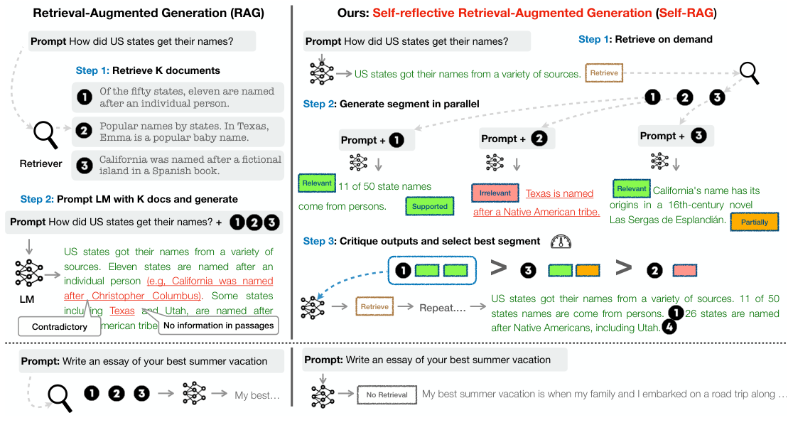
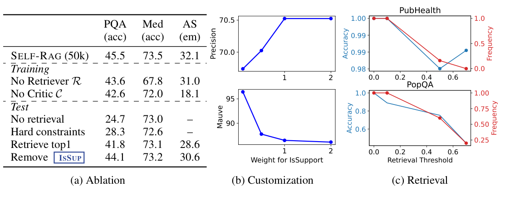
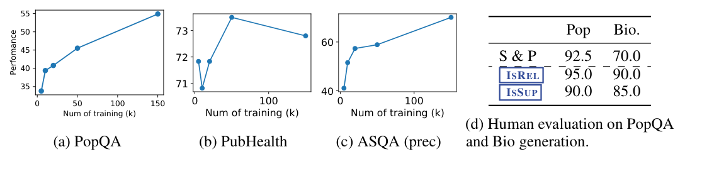

### Перевод статьи

**Self-RAG: обучение поиску, генерации и критике посредством саморефлексии**

***Авторы**: Asai A., Wu Z., Wang Y., Sil A., Hajishirzi H. (2024)*

*Вашингтонский университет; Институт искусственного интеллекта Аллена (Allen Institute for AI); IBM Research AI*

***Издание:** The Twelfth International Conference on Learning Representations (ICLR 2024). Перевод выполнен по препринту arXiv:2310.11511v1.*

**Аннотация (Abstract)**

Несмотря на свои выдающиеся возможности, большие языковые модели (LLM) часто дают ответы с фактическими неточностями, поскольку опираются исключительно на заключённые в них параметрические знания. Генерация, дополненная поиском (Retrieval-Augmented Generation, RAG), — это специализированный подход, при котором языковые модели (LM) дополняются поиском релевантных знаний; он уменьшает подобные проблемы. Однако если извлекать и включать во входные данные фиксированное число фрагментов текста без разбора, независимо от того, нужен ли поиск и релевантны ли найденные фрагменты, это снижает универсальность LM или может приводить к генерации бесполезных ответов. В работе предлагается новый фреймворк — генерация, дополненная поиском, с саморефлексией (**Self-Reflective Retrieval-Augmented Generation, Self-RAG**), — который повышает качество и фактическую точность ответов LM за счёт поиска и саморефлексии. Фреймворк обучает одну произвольную LM, которая адаптивно извлекает фрагменты по требованию, генерирует текст и оценивает как извлечённые фрагменты, так и собственные результаты генерации с помощью специальных токенов — так называемых *токенов рефлексии*. Генерация токенов рефлексии делает LM управляемой на этапе инференса и позволяет приспосабливать её поведение к требованиям различных задач. Эксперименты показывают, что Self-RAG (7 и 13 млрд параметров) значительно превосходит передовые LLM и модели, дополненные поиском, на разнообразных задачах. В частности, Self-RAG превосходит ChatGPT и Llama2-chat, дополненную поиском, в задачах ответов на вопросы в открытой предметной области, рассуждения и проверки фактов, а также существенно повышает по сравнению с этими моделями фактическую точность и точность цитирования при генерации развёрнутых текстов.[^1]

**1. Введение (Introduction)**

Передовые LLM по-прежнему допускают фактические ошибки (Mallen et al., 2023; Min et al., 2023), несмотря на рост размеров моделей и объёмов данных (Ouyang et al., 2022). Методы генерации, дополненной поиском (RAG) (рис. 1, слева; Lewis et al. 2020; Guu et al. 2020), дополняют входные данные LLM релевантными извлечёнными фрагментами и тем самым уменьшают число фактических ошибок в задачах, требующих обширных знаний (Ram et al., 2023; Asai et al., 2023a). Однако эти методы могут снижать универсальность LLM или добавлять ненужные и не относящиеся к делу фрагменты, что ведёт к генерации текста низкого качества (Shi et al., 2023), поскольку фрагменты извлекаются без разбора, независимо от того, полезна ли опора на факты. Кроме того, нет гарантии, что ответ будет согласован с извлечёнными релевантными фрагментами (Gao et al., 2023), поскольку модели не обучаются явно использовать факты из предоставленных фрагментов и следовать им. В данной работе предлагается генерация, дополненная поиском, с саморефлексией (**Self-Reflective Retrieval-augmented Generation, Self-RAG**), которая повышает качество генерации LLM, в том числе её фактическую точность, не жертвуя универсальностью, за счёт поиска по требованию и саморефлексии. Произвольная LM сквозным образом обучается анализировать собственный процесс генерации для заданных входных данных задачи: она генерирует как результат решения задачи, так и перемежающие его специальные токены (*токены рефлексии*). Токены рефлексии делятся на токены *поиска* и токены *критики*: первые указывают на необходимость поиска, вторые — на качество генерации (рис. 1, справа). Получив входной промпт и предшествующую генерацию, Self-RAG сначала определяет, будет ли полезно дополнить дальнейшую генерацию извлечёнными фрагментами. Если да, модель выдаёт токен **поиска**, который по требованию вызывает поисковую модель (шаг 1). Затем Self-RAG параллельно обрабатывает несколько извлечённых фрагментов, оценивает их релевантность и **генерирует** соответствующие результаты (шаг 2). После этого модель генерирует токены критики, чтобы **оценить** собственный результат и выбрать лучший вариант (шаг 3) с точки зрения фактической точности и общего качества. Этот процесс отличается от традиционного RAG (рис. 1, слева), который всегда извлекает фиксированное число документов для генерации, независимо от того, нужен ли поиск (например, пример на нижней части рисунка не требует фактических знаний), и никогда не возвращается к оценке качества генерации. Кроме того, Self-RAG снабжает каждый сегмент ссылками на источники с собственной оценкой того, подтверждается ли результат фрагментом, что упрощает проверку фактов.

Self-RAG обучает произвольную LM генерировать текст с токенами рефлексии, сводя их к предсказанию следующего токена из расширенного словаря модели. Модель-генератор обучается на разнообразной коллекции текстов, в которые вставлены токены рефлексии и извлечённые фрагменты. Токены рефлексии, созданные по аналогии с моделями вознаграждения в обучении с подкреплением (Ziegler et al., 2019; Ouyang et al., 2022), вставляются в исходный корпус заранее (офлайн) обученной моделью-*критиком*. Благодаря этому модель-критик не нужно держать в памяти во время обучения, что снижает накладные расходы. Модель-критик частично обучается на наборе данных из входов, выходов и соответствующих токенов рефлексии, собранном с помощью промптов к проприетарной LM (а именно GPT-4; OpenAI 2023). Хотя предлагаемый подход вдохновлён работами, в которых управляющие токены используются для запуска и направления генерации текста (Lu et al., 2022; Keskar et al., 2019), обученная LM использует токены критики для оценки собственных предсказаний после каждого сгенерированного сегмента как неотъемлемую часть результата генерации.

Кроме того, Self-RAG позволяет использовать настраиваемый алгоритм декодирования, удовлетворяющий жёстким или мягким ограничениям, которые задаются предсказаниями токенов рефлексии. В частности, алгоритм, работающий на этапе инференса, позволяет (1) гибко настраивать частоту поиска для разных прикладных задач и (2) подстраивать поведение моделей под предпочтения пользователей с помощью токенов рефлексии — за счёт лучевого поиска на уровне сегментов, в котором оценкой сегмента служит взвешенная линейная сумма вероятностей токенов рефлексии.



*Рис. 1. Общая схема Self-RAG. Self-RAG обучается выполнять поиск, критиковать и генерировать текстовые фрагменты, чтобы повысить общее качество генерации, её фактическую точность и проверяемость.*

Эмпирические результаты на шести задачах, включая рассуждение и генерацию развёрнутых текстов, показывают, что Self-RAG значительно превосходит предобученные и дообученные на инструкциях LLM с большим числом параметров, а также широко распространённые подходы RAG, обеспечивая более высокую точность цитирования. В частности, Self-RAG превосходит ChatGPT, дополненную поиском, на четырёх задачах, а Llama2-chat (Touvron et al., 2023) и Alpaca (Dubois et al., 2023) — на всех задачах. Анализ подтверждает результативность обучения и инференса с токенами рефлексии как для повышения общего качества, так и для настройки модели на этапе тестирования (например, для поиска компромисса между точностью цитирования и полнотой ответа).

**2. Обзор родственных работ (Related Work)**

***Генерация, дополненная поиском (Retrieval-Augmented Generation).*** Генерация, дополненная поиском (RAG), дополняет входное пространство LM извлечёнными текстовыми фрагментами (Guu et al., 2020; Lewis et al., 2020). Это даёт значительный прирост качества в задачах, требующих обширных знаний, как после дообучения, так и при использовании готовых LM (Ram et al., 2023). В одной из недавних работ (Luo et al., 2023) LM дообучается на инструкциях с фиксированным числом извлечённых фрагментов, добавленных перед входными данными; в другой ретривер и LM совместно предобучаются, а затем дообучаются на наборах данных задач по нескольким примерам (few-shot) (Izacard et al., 2022b). Если в прежних работах поиск, как правило, выполняется лишь один раз в начале, то Jiang et al. (2023) предлагают адаптивно извлекать фрагменты в ходе генерации поверх проприетарной LLM, а Schick et al. (2023) обучают LM генерировать вызовы API для именованных сущностей. Однако повышение качества решения задач в таких подходах часто достигается ценой эффективности во время работы (Mallen et al., 2023), устойчивости к нерелевантному контексту (Shi et al., 2023) и отсутствия атрибуции, т. е. указания источников (Liu et al., 2023a; Gao et al., 2023). В данной работе предлагается метод, позволяющий обучить произвольную LM использовать поиск *по требованию* для разнообразных запросов с инструкциями, а также управляемая генерация на основе токенов рефлексии, дополнительно повышающая качество генерации и атрибуции.

***Параллельные работы по RAG (Concurrent RAG work).*** В ряде параллельных работ[^2] по RAG предлагаются новые стратегии обучения или составления промптов, улучшающие широко распространённые подходы RAG. Lin et al. (2023) в два этапа дообучают и ретривер, и LM на наборах данных с инструкциями. Self-RAG также обучается на разнообразных наборах данных с инструкциями, но, в отличие от этой работы, обеспечивает поиск по требованию и выбор наилучшего возможного результата модели за счёт детальной саморефлексии, что делает его широко применимым, более устойчивым и управляемым. Yoran et al. (2023) используют модель логического вывода на естественном языке (natural language inference), а Xu et al. (2023) — модель реферирования, чтобы отфильтровать или сжать извлечённые фрагменты, прежде чем передать их в промпт LM для генерации ответа. Self-RAG обрабатывает фрагменты параллельно и отфильтровывает нерелевантные с помощью саморефлексии, не прибегая на этапе инференса к внешним моделям. Кроме того, механизм саморефлексии оценивает и другие аспекты качества результата, включая фактическую точность. В работе LATS (Zhou et al., 2023) готовые LM с помощью промптов ищут релевантную информацию для задач ответа на вопросы и генерируют ответ с поиском по дереву, направляемым сгенерированными LM оценками ценности. Если их функция ценности даёт лишь общую оценку каждого варианта генерации, то Self-RAG обучает произвольную LM генерировать детальную саморефлексию и поддерживает настраиваемый инференс.

***Обучение и генерация с критиками (Training and generating with critics).*** Обучение LLM с подкреплением (например, с помощью алгоритма проксимальной оптимизации стратегии, Proximal Policy Optimization, PPO; Schulman et al. 2017) на основе обратной связи от человека (RLHF) показало свою результативность для согласования LLM с предпочтениями людей (Ouyang et al., 2022). Wu et al. (2023) предлагают детальное RLHF с несколькими моделями вознаграждения. В данной работе также исследуется детальная критика поиска и генерации, однако целевая LM обучается на примерах задач, заранее (офлайн) дополненных токенами рефлексии от модели-критика, что обходится значительно дешевле, чем RLHF. Кроме того, токены рефлексии в Self-RAG обеспечивают управляемую генерацию на этапе инференса, тогда как RLHF нацелено на согласование с предпочтениями людей во время обучения. В других работах для управления генерацией LM используются общие управляющие токены (Lu et al., 2022; Korbak et al., 2023), тогда как Self-RAG использует токены рефлексии, чтобы решать, нужен ли поиск, и самостоятельно оценивать качество генерации. Xie et al. (2023) предлагают фреймворк декодирования, управляемого самооценкой, но рассматривают только задачи рассуждения с одним измерением оценки (согласованностью цепочки рассуждений) и без поиска. В недавних работах по уточнению результатов LLM (Dhuliawala et al., 2023; Madaan et al., 2023; Paul et al., 2023) модель с помощью промптов итеративно генерирует результат задачи, обратную связь на естественном языке и уточнённый результат, но ценой эффективности инференса.

**3. Self-RAG: обучение поиску, генерации и критике (Self-RAG: Learning to Retrieve, Generate and Critique)**

Предлагается генерация, дополненная поиском, с саморефлексией (Self-RAG), схема которой показана на рис. 1. Self-RAG — это фреймворк, который повышает качество и фактическую точность ответов LLM за счёт поиска и саморефлексии, не жертвуя исходной креативностью и универсальностью LLM. Сквозное обучение позволяет LM $\mathcal{M}$ **генерировать** текст с опорой на **извлечённые** фрагменты, если это необходимо, и **критиковать** результат, генерируя специальные токены. Эти *токены рефлексии* (табл. 1) сигнализируют о необходимости поиска или подтверждают релевантность, обоснованность и полноту результата. Распространённые же подходы RAG извлекают фрагменты без разбора и не гарантируют, что результат полностью подтверждается цитируемыми источниками.

**3.1. Формализация задачи и общая схема (Problem Formalization and Overview)**

Формально по входным данным $x$ модель $\mathcal{M}$ обучается последовательно генерировать текстовый результат $y$, состоящий из нескольких сегментов $y = {\lbrack{y_{1},\ldots,y_{T}}\rbrack}$, где $y_{t}$ — последовательность токенов $t$-го сегмента.[^3] Сгенерированные токены в $y_{t}$ включают как текст из исходного словаря, так и токены рефлексии (табл. 1).

*Таблица 1. Четыре типа токенов рефлексии в Self-RAG. Каждый тип представлен несколькими токенами, соответствующими его возможным значениям. Три нижние строки — три типа токенов критики (**Critique**); полужирным выделены наиболее желательные значения токенов критики. $x,y,d$ обозначают соответственно входные данные, результат и релевантный фрагмент.*

| Тип | Вход | Выход | Определение |
|----------------|--------------|------------------------------------------|----------------------------------|
| **Retrieve** | $x$ / $x,y$ | {yes, no, continue} (да, нет, продолжить) | Решает, когда выполнять поиск с помощью $\mathcal{R}$ |
| **IsRel** | $x,d$ | {**relevant**, irrelevant} (релевантен, нерелевантен) | $d$ содержит полезную для решения $x$ информацию |
| **IsSup** | $x,d,y$ | {**fully supported**, partially supported, no support} (полностью подтверждено, частично подтверждено, не подтверждено) | Все требующие проверки утверждения в $y$ подтверждаются $d$ |
| **IsUse** | $x,y$ | {**5**, 4, 3, 2, 1} | $y$ — полезный ответ на $x$ |

***Алгоритм 1.*** *Инференс Self-RAG*

Требуется: модель-генератор $\mathcal{M}$, ретривер $\mathcal{R}$, крупная коллекция текстовых фрагментов $\{ d_{1},\ldots,d_{N}\}$

1: **Вход:** входной промпт $x$ и предшествующая генерация $y_{< t}$; **выход:** следующий сегмент результата $y_{t}$

2: $\mathcal{M}$ предсказывает **Retrieve** по $(x,y_{< t})$

3: **если** **Retrieve** == Yes, **то**

4:   извлечь релевантные текстовые фрагменты $\mathbf{D}$ с помощью $\mathcal{R}$ по $(x,y_{t - 1})$ $\vartriangleright$ поиск (Retrieve)

5:   $\mathcal{M}$ предсказывает **IsRel** по $x,d$ и $y_{t}$ по $x,d,y_{< t}$ для каждого $d \in \mathbf{D}$ $\vartriangleright$ генерация (Generate)

6:   $\mathcal{M}$ предсказывает **IsSup** и **IsUse** по $x,y_{t},d$ для каждого $d \in \mathbf{D}$ $\vartriangleright$ критика (Critique)

7:   ранжировать $y_{t}$ на основе **IsRel**, **IsSup**, **IsUse** $\vartriangleright$ подробнее в разд. 3.3

8: **иначе если** **Retrieve** == No, **то**

9:   $\mathcal{M}_{gen}$ предсказывает $y_{t}$ по $x$ $\vartriangleright$ генерация (Generate)

10:   $\mathcal{M}_{gen}$ предсказывает **IsUse** по $x,y_{t}$ $\vartriangleright$ критика (Critique)

***Общая схема инференса (Inference overview).*** На рис. 1 и в алгоритме 1 представлена общая схема работы Self-RAG на этапе инференса. Для каждого входа $x$ и предшествующей генерации $y_{< t}$ модель декодирует токен поиска, чтобы оценить пользу поиска. Если поиск не требуется, модель предсказывает следующий сегмент результата, как обычная LM. Если поиск нужен, модель генерирует токен критики, оценивающий релевантность извлечённого фрагмента, затем следующий сегмент ответа и токен критики, оценивающий, подтверждается ли информация в сегменте ответа этим фрагментом. Наконец, ещё один токен критики оценивает общую полезность ответа.[^4] Для генерации каждого сегмента Self-RAG параллельно обрабатывает несколько фрагментов и с помощью собственных сгенерированных токенов рефлексии накладывает на результат мягкие ограничения (разд. 3.3) или жёсткое управление (алгоритм 1). Например, на рис. 1 (справа) на первом временном шаге выбирается извлечённый фрагмент $d_{1}$, поскольку $d_{2}$ не содержит прямых доказательств (**IsRel** имеет значение Irrelevant), а результат по $d_{3}$ подтверждён лишь частично, тогда как результат по $d_{1}$ подтверждён полностью.

***Общая схема обучения (Training overview).*** Self-RAG позволяет произвольной LM генерировать текст с токенами рефлексии, сводя их к предсказанию следующего токена из расширенного словаря модели (т. е. исходного словаря, дополненного токенами рефлексии). Модель-генератор $\mathcal{M}$ обучается на подготовленном корпусе, в котором перемежаются фрагменты, извлечённые *ретривером* $\mathcal{R}$, и токены рефлексии, предсказанные моделью-*критиком* $\mathcal{C}$ (кратко процедура описана в алгоритме 2 приложения). Модель $\mathcal{C}$ обучается генерировать токены рефлексии для оценки извлечённых фрагментов и качества заданного результата задачи (разд. 3.2.1). С помощью модели-критика обучающий корпус заранее (офлайн) обновляется: в результаты задач вставляются токены рефлексии. Затем итоговая модель-генератор ($\mathcal{M}$) обучается с обычной целевой функцией языкового моделирования (разд. 3.2.2), чтобы $\mathcal{M}$ могла сама генерировать токены рефлексии, не обращаясь к критику на этапе инференса.

**3.2. Обучение Self-RAG (Self-RAG Training)**

В данном разделе описываются сбор размеченных данных и обучение двух моделей: модели-критика $\mathcal{C}$ (разд. 3.2.1) и модели-генератора $\mathcal{M}$ (разд. 3.2.2).

**3.2.1. Обучение модели-критика (Training the Critic Model)**

***Сбор данных для модели-критика (Data collection for critic model).*** Ручная разметка токенов рефлексии для каждого сегмента обходится дорого (Wu et al., 2023). Для генерации такой обратной связи можно успешно использовать передовую LLM, например GPT-4 (OpenAI, 2023) (Liu et al., 2023b). Однако зависимость от проприетарных LM может увеличивать затраты на API и снижать воспроизводимость (Chen et al., 2023). Поэтому размеченные данные создаются с помощью промптов, побуждающих GPT-4 генерировать токены рефлексии, после чего её знания дистиллируются в собственную модель $\mathcal{C}$. Для каждой группы токенов рефлексии из исходных обучающих данных случайным образом отбираются примеры: ${\{ X^{sample},Y^{sample}\}} \sim {\{ X,Y\}}$. Поскольку у разных групп токенов рефлексии свои определения и входные данные (см. табл. 1), для них используются разные промпты с инструкциями. Рассмотрим в качестве примера **Retrieve**. GPT-4 получает инструкцию, специфичную для данного типа («Given an instruction, make a judgment on whether finding some external documents from the web helps to generate a better response» — «По инструкции определи, поможет ли поиск внешних документов в интернете сгенерировать лучший ответ»), за которой следуют несколько примеров (few-shot) $I$, исходный вход задачи $x$ и результат $y$; модель должна предсказать подходящий токен рефлексии в виде текста: $p\left. (r \middle| {I,x,y}) \right.$. Ручная проверка показывает, что предсказания токенов рефлексии моделью GPT-4 хорошо согласуются с оценками людей. Для каждого типа собирается от 4 до 20 тыс. размеченных обучающих примеров, которые объединяются в обучающие данные для $\mathcal{C}$. Полный список инструкций приведён в разделе D приложения, а подробности и анализ — в разделе A.1.

***Обучение критика (Critic learning).*** После сбора обучающих данных $\mathcal{D}_{critic}$ модель $\mathcal{C}$ инициализируется предобученной LM и обучается на $\mathcal{D}_{critic}$ со стандартной целевой функцией условного языкового моделирования, т. е. путём максимизации правдоподобия:

$$\max\limits_{\mathcal{C}}{\mathbb{E}}_{{({(x,y)},r)} \sim \mathcal{D}_{critic}}\log p_{\mathcal{C}}{(r|x,y)}, \quad r \text{ — токены рефлексии.} \qquad (1)$$

Хотя исходной моделью может быть любая предобученная LM, для инициализации $\mathcal{C}$ используется та же модель, что и для генератора (а именно Llama 2-7B; Touvron et al. 2023). Для большинства категорий токенов рефлексии согласие критика с предсказаниями GPT-4 превышает 90% (табл. 5 приложения).


*Рис. 2. Примеры обучающих данных Self-RAG. Левый пример не требует поиска, правый требует, поэтому в него вставлены фрагменты. Другие примеры приведены в табл. 4 приложения.*

**3.2.2. Обучение модели-генератора (Training the Generator Model)**

***Сбор данных для генератора (Data collection for generator).*** Для пары «вход — выход» $(x,y)$ исходный результат $y$ дополняется с помощью поисковой модели и модели-критика, чтобы получить размеченные данные, точно воспроизводящие процесс инференса Self-RAG (разд. 3.1). Для каждого сегмента $y_{t} \in y$ запускается $\mathcal{C}$, чтобы оценить, могут ли дополнительные фрагменты улучшить генерацию. Если поиск требуется, добавляется специальный токен поиска **Retrieve** =Yes, и $\mathcal{R}$ извлекает $K$ наиболее релевантных фрагментов $\mathbf{D}$. Для каждого фрагмента $\mathcal{C}$ затем оценивает, релевантен ли он, и предсказывает **IsRel**. Если фрагмент релевантен, $\mathcal{C}$ дополнительно оценивает, подтверждает ли он сгенерированный моделью текст, и предсказывает **IsSup**. Токены критики **IsRel** и **IsSup** добавляются после извлечённого фрагмента или сгенерированного текста. В конце результата $y$ (или $y_{T}$) $\mathcal{C}$ предсказывает токен общей полезности **IsUse**, и дополненный токенами рефлексии результат вместе с исходным входом добавляется в $\mathcal{D}_{gen}$. Пример обучающих данных приведён на рис. 2.

***Обучение генератора (Generator learning).*** Модель-генератор $\mathcal{M}$ обучается на подготовленном корпусе $\mathcal{D}_{gen}$, дополненном токенами рефлексии, со стандартной целевой функцией предсказания следующего токена:

$$\max\limits_{\mathcal{M}}{\mathbb{E}}_{{(x,y,r)} \sim \mathcal{D}_{gen}}\log p_{\mathcal{M}}\left. ({y,r} \middle| x) \right.. \qquad (2)$$

В отличие от обучения $\mathcal{C}$ (уравнение 1), $\mathcal{M}$ учится предсказывать как целевой результат, так и токены рефлексии. Во время обучения извлечённые фрагменты текста (заключённые между \<p\> и \</p\> на рис. 2) маскируются при вычислении функции потерь, а исходный словарь $\mathcal{V}$ расширяется набором токенов рефлексии $\{\text{Critique}, \text{Retrieve}\}$.

***Связь с предшествующими работами по обучению с критикой (Connections to prior work on learning with critique).*** В недавних работах при обучении используется дополнительная критика (обратная связь), например RLHF (Ouyang et al. 2022) с помощью PPO. Если PPO во время обучения опирается на отдельные модели вознаграждения, то в Self-RAG критика вычисляется заранее (офлайн) и вставляется непосредственно в обучающий корпус, а модель-генератор обучается со стандартной целевой функцией языкового моделирования. Это значительно снижает затраты на обучение по сравнению с PPO. Работа связана и с исследованиями, в которых для управления генерацией используются специальные токены (Keskar et al., 2019; Lu et al., 2022; Korbak et al., 2023). Self-RAG учится генерировать специальные токены, *чтобы оценивать собственное предсказание* после каждого сгенерированного сегмента, что позволяет на этапе инференса применять механизм мягкого переранжирования или жёсткие ограничения (см. далее).

**3.3. Инференс Self-RAG (Self-RAG Inference)**

Генерация токенов рефлексии для самооценки собственного результата делает Self-RAG управляемой на этапе инференса и позволяет приспосабливать её поведение к требованиям различных задач. В задачах, требующих фактической точности (Min et al., 2023), модель должна чаще извлекать фрагменты, чтобы результат точно соответствовал имеющимся доказательствам. Напротив, в более открытых задачах, например при написании эссе о личном опыте, акцент смещается в сторону более редкого поиска и приоритета общей креативности или полезности. В данном разделе описываются способы управления, позволяющие достигать этих разных целей в процессе инференса.

***Адаптивный поиск с порогом (Adaptive retrieval with threshold).*** Self-RAG динамически решает, когда извлекать текстовые фрагменты, предсказывая **Retrieve**. Кроме того, фреймворк позволяет задать порог: если вероятность генерации токена **Retrieve**=Yes, нормированная по всем выходным токенам **Retrieve**, превышает заданный порог, запускается поиск (подробнее — в разделе A.3 приложения).

***Древовидное декодирование с токенами критики (Tree-decoding with critique tokens).*** На каждом шаге сегмента $t$, когда требуется поиск (по жёсткому или мягкому условию), $\mathcal{R}$ извлекает $K$ фрагментов, а генератор $\mathcal{M}$ параллельно обрабатывает каждый фрагмент и выдаёт $K$ различных вариантов продолжения. Выполняется лучевой поиск на уровне сегментов (с шириной луча $B$), чтобы на каждом временном шаге $t$ получить $B$ лучших продолжений сегмента; в конце генерации возвращается лучшая последовательность. Оценка каждого сегмента $y_{t}$ относительно фрагмента $d$ обновляется оценкой критика $\mathcal{S}$, которая представляет собой линейную взвешенную сумму нормированных вероятностей токенов критики каждого типа (**Critique**). Для каждой группы токенов критики $G$ (например, **IsRel**) её оценка на временном шаге $t$ обозначается $s_{t}^{G}$, а оценка сегмента вычисляется следующим образом:

$$f(y_{t}, d, \text{Critique}) = p\left. (y_{t} \middle| {x,d,y_{< t}}) \right. + \mathcal{S}(\text{Critique}), \quad \text{где} \qquad (3)$$

$$\mathcal{S}(\text{Critique}) = \sum\limits_{G \in \mathcal{G}}{w^{G}s_{t}^{G}} \quad \text{для} \quad \mathcal{G} = \{\text{IsRel}, \text{IsSup}, \text{IsUse}\}, \qquad (4)$$

где $s_{t}^{G} = \frac{p_{t}{(\hat{r})}}{\sum_{i = 1}^{N^{G}}{p_{t}{(r_{i})}}}$ — вероятность генерации наиболее желательного токена рефлексии $\hat{r}$ (например, **IsRel** =Relevant) для типа токенов критики $G$, имеющего $N^{G}$ различных токенов (соответствующих возможным значениям $G$). Веса $w^{G}$ в уравнении 4 — гиперпараметры, которые можно настраивать на этапе инференса, добиваясь нужного поведения модели при тестировании. Например, чтобы результат $y$ в основном подтверждался доказательствами, можно увеличить вес оценки **IsSup**, относительно уменьшив веса других аспектов. Кроме того, можно накладывать при декодировании жёсткие ограничения с помощью **Critique**: вместо мягкой функции вознаграждения из уравнения 4 явно отбрасывать продолжение сегмента, если модель генерирует нежелательный токен **Critique** (например, **IsSup** =No support). Поиск баланса между несколькими предпочтениями изучался в рамках RLHF (Touvron et al., 2023; Wu et al., 2023), где для изменения поведения моделей, как правило, требуется обучение. Self-RAG настраивает LM без дополнительного обучения.

**4. Эксперименты (Experiments)**

**4.1. Задачи и наборы данных (Tasks and Datasets)**

Self-RAG и разнообразные базовые модели оцениваются на ряде прикладных задач; результаты оцениваются комплексно, метриками, учитывающими общую правильность, фактическую точность и беглость текста. Во всех экспериментах используется оценка в режиме zero-shot: модели получают инструкции с описанием задач без примеров (few-shot) (Wei et al., 2022; Sanh et al., 2022). Подробности условий экспериментов, включая инструкции на этапе тестирования, приведены в разделе B.1 приложения.

***Задачи с закрытым набором ответов (Closed-set tasks)*** включают два набора данных: *набор для проверки фактов* в области общественного здравоохранения (**PubHealth**; Zhang et al. 2023) и *набор задач на рассуждение с выбором ответа*, составленный на основе научных экзаменов (**ARC-Challenge**; Clark et al. 2018). В качестве метрики используется точность (accuracy), результаты приводятся на тестовой выборке. Для обоих наборов данных агрегируются вероятности ответов целевых классов (раздел B.2 приложения).

***Задачи генерации коротких ответов (Short-form generations tasks)*** включают два набора данных для ответов на вопросы в открытой предметной области — PopQA (Mallen et al., 2023) и TriviaQA-unfiltered (Joshi et al., 2017), в которых система должна отвечать на произвольные вопросы о фактических знаниях. Для PopQA используется подмножество «длинного хвоста» (long-tail) — 1399 запросов о редких сущностях, страницы которых в Википедии просматриваются менее 100 раз в месяц. Поскольку тестовая выборка TriviaQA-unfiltered (open) не опубликована, вслед за предшествующими работами (Min et al., 2019; Guu et al., 2020) используется их разбиение на валидационную и тестовую выборки — для оценки берутся 11 313 тестовых запросов. Вслед за Mallen et al. (2023) и Schick et al. (2023) качество оценивается по тому, содержится ли эталонный ответ в сгенерированном моделью тексте, а не по строгому точному совпадению.

***Задачи генерации развёрнутых текстов (Long-form generation tasks)*** включают генерацию биографий (Min et al., 2023) и задачу развёрнутых ответов на вопросы **ALCE-ASQA** Gao et al. (2023); Stelmakh et al. (2022). Биографии оцениваются метрикой FactScore (Min et al., 2023), а для ASQA используются официальные метрики правильности (str-em), беглости на основе MAUVE (Pillutla et al., 2021), а также точности и полноты цитирования (Gao et al., 2023).[^5]

**4.2. Базовые модели (Baselines)**

***Базовые модели без поиска (Baselines without retrievals).*** Оцениваются сильные общедоступные предобученные LLM — Llama2 (7B и 13B) (Touvron et al., 2023), модели, дообученные на инструкциях, — Alpaca (7B и 13B) (Dubois et al., 2023) (собственное воспроизведение на основе Llama2), а также модели, обученные и дообученные с подкреплением на закрытых данных, — ChatGPT (Ouyang et al., 2022) и Llama2-chat 13B. Для LM, дообученных на инструкциях, используется официальный системный промпт или формат инструкций, применявшийся при обучении, если он опубликован. Метод также сравнивается с параллельной работой CoVE (65B) (Dhuliawala et al., 2023), в которой для повышения фактической точности генерации LLM применяется итеративное составление промптов.

***Базовые модели с поиском (Baselines with retrievals).*** Оцениваются модели, дополненные поиском на этапе тестирования или во время обучения. Первая категория включает стандартные базовые модели RAG, в которых LM (Llama2, Alpaca) генерирует результат по запросу, перед которым добавлены наиболее релевантные документы, извлечённые тем же ретривером, что и в Self-RAG. Сюда же относится Llama2-FT — модель Llama2, дообученная на всех используемых обучающих данных, но без токенов рефлексии и извлечённых фрагментов. Приводятся также результаты базовых моделей с поиском на основе LM, обученных на закрытых данных, — Ret-ChatGPT и Ret-Llama2-chat, использующих тот же способ дополнения, а также perplexity.ai — промышленной поисковой системы на основе InstructGPT. Вторая категория включает параллельные методы, обучаемые с извлечёнными текстовыми фрагментами: SAIL (Luo et al., 2023), где LM дообучается на данных с инструкциями Alpaca, в которые перед инструкциями вставлены наиболее релевантные извлечённые документы, и Toolformer (Schick et al., 2023), где LM предобучается с вызовами API (например, API Википедии).[^6]

**4.3. Условия экспериментов (Experimental settings)**

***Обучающие данные и параметры (Training data and settings).*** Обучающие данные состоят из разнообразных пар «инструкция — результат». В частности, примеры отбираются из обработанных данных Open-Instruct (Wang et al., 2023) и из наборов данных, требующих обширных знаний (Petroni et al., 2021; Stelmakh et al., 2022; Mihaylov et al., 2018). Всего используется 150 тыс. пар «инструкция — результат». В качестве базовой LM генератора используются Llama2 7B и 13B (Touvron et al., 2023), в качестве базовой LM критика — Llama2 7B. В качестве поисковой модели $\mathcal{R}$ по умолчанию используется готовая модель Contriever-MS MARCO (Izacard et al., 2022a), которая извлекает до десяти документов для каждого входа. Дополнительные подробности обучения приведены в разделе B.1 приложения.

***Параметры инференса (Inference settings).*** В конфигурации по умолчанию весам **IsRel**, **IsSup** и **IsUse** присваиваются значения 1,0, 1,0 и 0,5 соответственно. Чтобы поиск выполнялся чаще, порог поиска для большинства задач устанавливается равным 0,2, а для ALCE (Gao et al., 2023) — 0 из-за требований к цитированию. Инференс ускоряется с помощью vllm (Kwon et al., 2023). На уровне сегментов используется ширина луча 2, на уровне токенов — жадное декодирование. По умолчанию используются пять наиболее релевантных документов от Contriever-MS MARCO (Izacard et al., 2022a); для биографий и ответов на вопросы в открытой предметной области вслед за Luo et al. (2023) дополнительно используются пять наиболее релевантных документов, найденных веб-поисковиком; для ASQA для корректного сравнения во всех базовых моделях используются предоставленные авторами набора пять наиболее релевантных документов, найденных GTR-XXL (Ni et al., 2022).

**5. Результаты и анализ (Results and Analysis)**

*Таблица 2. Общие результаты экспериментов на шести задачах. Полужирным выделены лучшие результаты среди непроприетарных моделей; в строках моделей, обученных на закрытых данных, полужирным (в оригинале — серым полужирным) выделен лучший результат проприетарной модели, если она превосходит все непроприетарные. Звёздочкой (\*) отмечены результаты параллельных или недавних работ, приведённые в этих работах. Прочерк (–) означает, что результат не приводится в исходных статьях или неприменим. Модели упорядочены по размеру. FS, em, rg, mau, pre, rec обозначают соответственно FactScore (фактическая точность), str-em и rouge (правильность), MAUVE (беглость), точность и полноту цитирования. В переводе таблица для удобства чтения разбита на две части.*

*(а) Короткие ответы и задачи с закрытым набором ответов*

| Модель | PopQA (acc) | TQA (acc) | Pub (acc) | ARC (acc) |
|------------------------------|----------|----------|----------|----------|
| *LM, обученные на закрытых данных* |  |  |  |  |
| Llama2-c 13B | 20,0 | 59,3 | 49,4 | 38,4 |
| Ret-Llama2-c 13B | 51,8 | 59,8 | 52,1 | 37,9 |
| ChatGPT | 29,3 | **74,3** | 70,1 | **75,3** |
| Ret-ChatGPT | 50,8 | 65,7 | 54,7 | **75,3** |
| Perplexity.ai | – | – | – | – |
| *Базовые модели без поиска* |  |  |  |  |
| Llama2 7B | 14,7 | 30,5 | 34,2 | 21,8 |
| Alpaca 7B | 23,6 | 54,5 | 49,8 | 45,0 |
| Llama2 13B | 14,7 | 38,5 | 29,4 | 29,4 |
| Alpaca 13B | 24,4 | 61,3 | 55,5 | 54,9 |
| CoVE\* 65B | – | – | – | – |
| *Базовые модели с поиском* |  |  |  |  |
| Toolformer\* 6B | – | 48,8 | – | – |
| Llama2 7B | 38,2 | 42,5 | 30,0 | 48,0 |
| Alpaca 7B | 46,7 | 64,1 | 40,2 | 48,0 |
| Llama2-FT 7B | 48,7 | 57,3 | 64,3 | 65,8 |
| SAIL\* 7B | – | – | 69,2 | 48,4 |
| Llama2 13B | 45,7 | 47,0 | 30,2 | 26,0 |
| Alpaca 13B | 46,1 | 66,9 | 51,1 | 57,6 |
| **Наш Self-RAG 7B** | 54,9 | 66,4 | 72,4 | 67,3 |
| **Наш Self-RAG 13B** | **55,8** | **69,3** | **74,5** | **73,1** |

*(б) Генерация развёрнутых текстов (с цитированием)*

| Модель | Bio (FS) | ASQA (em) | ASQA (rg) | ASQA (mau) | ASQA (pre) | ASQA (rec) |
|------------------------------|----------|----------|----------|----------|----------|----------|
| *LM, обученные на закрытых данных* |  |  |  |  |  |  |
| Llama2-c 13B | 55,9 | 22,4 | 29,6 | 28,6 | – | – |
| Ret-Llama2-c 13B | 79,9 | 32,8 | 34,8 | 43,8 | 19,8 | 36,1 |
| ChatGPT | 71,8 | 35,3 | 36,2 | 68,8 | – | – |
| Ret-ChatGPT | – | **40,7** | **39,9** | **79,7** | 65,1 | **76,6** |
| Perplexity.ai | 71,2 | – | – | – | – | – |
| *Базовые модели без поиска* |  |  |  |  |  |  |
| Llama2 7B | 44,5 | 7,9 | 15,3 | 19,0 | – | – |
| Alpaca 7B | 45,8 | 18,8 | 29,4 | 61,7 | – | – |
| Llama2 13B | 53,4 | 7,2 | 12,4 | 16,0 | – | – |
| Alpaca 13B | 50,2 | 22,9 | 32,0 | 70,6 | – | – |
| CoVE\* 65B | 71,2 | – | – | – | – | – |
| *Базовые модели с поиском* |  |  |  |  |  |  |
| Toolformer\* 6B | – | – | – | – | – | – |
| Llama2 7B | 78,0 | 15,2 | 22,1 | 32,0 | 2,9 | 4,0 |
| Alpaca 7B | 76,6 | 30,9 | 33,3 | 57,9 | 5,5 | 7,2 |
| Llama2-FT 7B | 78,2 | 31,0 | 35,8 | 51,2 | 5,0 | 7,5 |
| SAIL\* 7B | – | – | – | – | – | – |
| Llama2 13B | 77,5 | 16,3 | 20,5 | 24,7 | 2,3 | 3,6 |
| Alpaca 13B | 77,7 | **34,8** | 36,7 | 56,6 | 2,0 | 3,8 |
| **Наш Self-RAG 7B** | **81,2** | 30,0 | 35,7 | **74,3** | 66,9 | 67,8 |
| **Наш Self-RAG 13B** | 80,2 | 31,7 | **37,0** | 71,6 | **70,3** | **71,3** |

**5.1. Основные результаты (Main Results)**

***Сравнение с базовыми моделями без поиска (Comparison against baselines without retrieval).*** В верхней части табл. 2 приведены базовые модели без поиска. Self-RAG (две нижние строки) значительно превосходит LLM, прошедшие дообучение с учителем, во всех задачах и даже превосходит ChatGPT на PubHealth, PopQA, генерации биографий и ASQA (по Rouge и MAUVE). Подход также значительно превосходит параллельный метод, использующий сложное составление промптов: в задаче генерации биографий модели Self-RAG 7B и 13B превосходят параллельный метод CoVE (Dhuliawala et al., 2023), который итеративно уточняет результат Llama2 65B с помощью промптов.

***Сравнение с базовыми моделями с поиском (Comparison against baselines with retrieval).*** Как видно из нижней части табл. 2, Self-RAG превосходит существующие методы RAG во многих задачах и показывает лучшие результаты среди моделей на основе непроприетарных LM во всех задачах. Хотя Self-RAG превосходит и другие базовые модели, на PopQA и Bio мощные LM, дообученные на инструкциях и дополненные поиском (например, Llama2-chat, Alpaca), дают большой прирост по сравнению со своими вариантами без поиска. Однако эти базовые модели плохо справляются с задачами, в которых нельзя просто скопировать или извлечь подстроки из найденных фрагментов. На PubHealth и ARC-Challenge базовые модели с поиском не дают заметного улучшения по сравнению с вариантами без поиска. Кроме того, большинство базовых моделей с поиском почти не повышают точность цитирования. На ASQA Self-RAG показывает значительно более высокие точность и полноту цитирования, чем все модели, кроме ChatGPT. Gao et al. (2023) установили, что в этой задаче ChatGPT неизменно превосходит меньшие LM. Self-RAG устраняет этот разрыв и даже превосходит ChatGPT по точности цитирования, которая показывает, полностью ли сгенерированное моделью утверждение подтверждается цитируемыми доказательствами. Также установлено, что по метрикам фактической точности Self-RAG 7B иногда превосходит модель 13B, поскольку меньшая модель Self-RAG чаще генерирует точно обоснованные, но более короткие ответы. Llama2-FT 7B — базовая LM, обученная на тех же парах «инструкция — результат», что и Self-RAG, но без поиска и саморефлексии и дополняемая поиском только на этапе тестирования, — уступает Self-RAG. Этот результат показывает, что выигрыш Self-RAG обусловлен не только обучающими данными, и подтверждает результативность фреймворка Self-RAG.



*Рис. 3. Анализ Self-RAG: (a) абляционные исследования ключевых компонентов обучения и инференса Self-RAG на модели 7B; (b) влияние мягких весов на точность цитирования в ASQA и MAUVE (беглость); (c) частота поиска и нормированная точность на PubHealth и PopQA.*

*Данные панели (a) рис. 3 — абляционный анализ:*

| Вариант | PQA (acc) | Med (acc) | AS (em) |
|------------------------------------|----------|----------|----------|
| Self-RAG (50 тыс.) | 45,5 | 73,5 | 32,1 |
| *Обучение (Training)* |  |  |  |
| Без ретривера $\mathcal{R}$ (No Retriever) | 43,6 | 67,8 | 31,0 |
| Без критика $\mathcal{C}$ (No Critic) | 42,6 | 72,0 | 18,1 |
| *Инференс (Test)* |  |  |  |
| Без поиска (No retrieval) | 24,7 | 73,0 | – |
| Жёсткие ограничения (Hard constraints) | 28,3 | 72,6 | – |
| Только первый документ (Retrieve top1) | 41,8 | 73,1 | 28,6 |
| Без **IsSup** (Remove **IsSup**) | 44,1 | 73,2 | 30,6 |

**5.2. Анализ (Analysis)**

***Абляционные исследования (Ablation studies).*** Чтобы выявить ключевые факторы, проведён ряд абляционных экспериментов. Оцениваются два варианта модели, обученные иначе, чем Self-RAG: *No Retriever* — LM, обученная стандартным способом следования инструкциям на парах «инструкция — результат» без извлечённых фрагментов; *No Critic* — LM, обученная на парах «вход — выход», которые всегда дополняются одним наиболее релевантным документом, но без токенов рефлексии. Последний вариант аналогичен SAIL (Luo et al., 2023), только вместо набора данных Alpaca (Dubois et al., 2023), как в SAIL, используются наши данные «инструкция — результат». Проводится также абляция алгоритма инференса: *No retrieval* — поиск во время инференса отключён; *Hard constraints* — модель выполняет поиск, когда **Retrieve**=Yes, а не по адаптивному порогу; *Retrieve top 1* — модель всегда выполняет поиск и использует только один наиболее релевантный документ, как в стандартных подходах RAG; *Remove **IsSup*** — из лучевого поиска, управляемого критикой (уравнение 4), исключается только оценка **IsSup**. В этом эксперименте для более эффективного перебора вариантов обучения используется обучающая выборка из 50 тыс. примеров; влияние объёма обучающих данных анализируется далее в этом разделе. Абляционные исследования проводятся на трёх наборах данных — PopQA, PubHealth и ASQA. На ASQA модели оцениваются на 150 отобранных примерах, а абляции, связанные с адаптивным поиском или его отсутствием, исключаются.

Результаты абляции приведены на рис. 3(a) (в тексте оригинала — «Table 3(a)»). В верхней части таблицы показаны результаты абляции обучения, в нижней — абляции инференса. Видно, что важную роль играют все компоненты. Наблюдается также большой разрыв между Self-RAG и вариантами без ретривера или критика на всех задачах: обучение LM с этими моделями вносит основной вклад в выигрыш Self-RAG. Использование первых по рангу фрагментов независимо от их релевантности (Retrieve top 1), как в традиционных подходах RAG, приводит к значительному падению качества на PopQA и ASQA, а исключение **IsSup** при лучевом поиске ухудшает результаты на ASQA. Это подтверждает результативность Self-RAG, которая тщательно отбирает варианты генерации по нескольким детальным критериям, а не просто использует все первые фрагменты, найденные поисковой моделью, и не полагается только на оценки релевантности.

***Влияние настройки на этапе инференса (Effects of inference-time customization).*** Одно из ключевых преимуществ предложенного фреймворка — возможность управлять тем, насколько каждый тип критики влияет на итоговый выбор при генерации. Влияние различных весов параметров анализируется на модели 7B на этапе инференса на ASQA, где учитывается несколько аспектов оценки. На рис. 3(b) показано, как влияет изменение веса **IsSup**, оценивающего, насколько результат подтверждается текстовым фрагментом. Как видно из рисунка, увеличение веса повышает точность цитирования, поскольку больший акцент делается на том, подтверждается ли сгенерированный текст доказательствами. Напротив, больший вес снижает оценку MAUVE: когда текст становится длиннее и беглее, в нём чаще встречаются утверждения, не полностью подтверждённые цитатами, что согласуется с выводами Liu et al. (2023a). Фреймворк позволяет специалистам выбирать и настраивать поведение моделей на этапе тестирования, изменяя такие параметры без дополнительного обучения.

***Компромисс между эффективностью и точностью (Efficiency and accuracy trade-off).*** С помощью фреймворка можно регулировать частоту поиска, используя вероятность токенов вознаграждения. Оценивается, как адаптивный порог влияет на общую точность и частоту поиска: качество измеряется при различных значениях порога $\delta$ (большее $\delta$ означает более редкий поиск) на PubHealth и PopQA. На рис. 3(c) видно, что при изменении $\delta$ частота поиска на обоих наборах данных меняется очень сильно. При этом снижение качества при более редком поиске невелико на PubHealth, но заметнее на PopQA.

***Влияние объёма обучающих данных (Effects of training data size).*** Проведён анализ того, как объём данных влияет на качество модели. В частности, из исходных 150 тыс. обучающих примеров случайным образом отбираются 5, 10, 20 и 50 тыс. примеров, и на этих подмножествах дообучаются четыре варианта Self-RAG 7B. Затем их качество на PopQA, PubHealth и ASQA (точность цитирования) сравнивается с итоговой моделью Self-RAG, обученной на всех 150 тыс. примерах. На рис. 4(a), 4(b) и 4(c) показано качество моделей, обученных на разном объёме данных. На всех наборах данных с ростом объёма данных качество, как правило, растёт, причём на PopQA и ASQA улучшения значительно больше; при этом у Llama2-FT 7B при увеличении обучающих данных с 50 до 150 тыс. столь значительных улучшений не наблюдается. Эти результаты также указывают на то, что дальнейшее расширение обучающих данных Self-RAG может привести к дальнейшему улучшению, хотя в данной работе объём обучающих данных ограничен 150 тыс. примеров.

***Оценка людьми (Human evaluations).*** Проведена небольшая оценка результатов Self-RAG людьми, а также надёжности предсказанных токенов рефлексии. В частности, отобрано по 50 примеров из результатов на PopQA и Bio. Вслед за Menick et al. (2022) разметчики оценивают показатель *S&P*, который отражает, является ли результат модели правдоподобным (т. е. разумным и относящимся к теме ответом на вопрос, как если бы он прозвучал в разговоре) и подтверждённым (т. е. приведённых доказательств достаточно, чтобы проверить правильность ответа). При оценке S&P не учитываются случаи, когда Self-RAG предсказывает нерелевантность или отсутствие подтверждения. Затем разметчиков спрашивают, совпадают ли предсказанные моделью токены рефлексии **IsRel** и **IsSup** с их собственной оценкой (например, действительно ли результат с меткой *fully supported* подтверждается цитируемыми доказательствами). Разметчики считают, что ответы Self-RAG часто правдоподобны и подтверждаются релевантными фрагментами, причём на коротких ответах PopQA оценка S&P выше, что согласуется с Menick et al. (2022). Разметчики также находят, что предсказания токенов рефлексии **IsRel** и **IsSup** в основном совпадают с их оценками. Несколько размеченных примеров с пояснениями приведены в табл. 6 приложения.



*Рис. 4. Объём обучающих данных и оценка людьми: (a), (b), (c) — анализ объёма обучающих данных, показывающий его влияние на PopQA, PubHealth и ASQA (точность цитирования) соответственно; (d) — оценка людьми результатов Self-RAG и токенов рефлексии.*

*Данные панели (d) рис. 4 — оценка людьми на PopQA и генерации биографий:*

| Показатель | Pop | Bio. |
|--------------------|----------|----------|
| S & P | 92,5 | 70,0 |
| **IsRel** | 95,0 | 90,0 |
| **IsSup** | 90,0 | 85,0 |

**6. Заключение (Conclusion)**

В данной работе предложен Self-RAG — новый фреймворк, повышающий качество и фактическую точность ответов LLM за счёт поиска по требованию и саморефлексии. Self-RAG обучает LM выполнять поиск, генерировать текст и критиковать как текстовые фрагменты, так и собственную генерацию, предсказывая следующие токены как из исходного словаря, так и из числа новых специальных токенов — токенов рефлексии. Кроме того, Self-RAG позволяет настраивать поведение LM на этапе тестирования с помощью токенов рефлексии. Комплексная оценка на шести задачах по нескольким метрикам показывает, что Self-RAG значительно превосходит LLM с большим числом параметров, а также LLM с традиционными подходами к генерации, дополненной поиском.

**Этические аспекты (Ethical Concerns)**

Работа направлена на повышение фактической точности результатов LLM, недостаток которой по-прежнему порождает множество практических проблем (например, распространение дезинформации и неверные или опасные советы). Хотя предложенный метод значительно улучшает качество, фактическую точность и точность цитирования, он всё ещё может генерировать результаты, не полностью подтверждённые цитатами. Мы надеемся, что явная саморефлексия и детальная атрибуция помогут пользователям выявлять фактические ошибки в результатах модели.

**Благодарности (Acknowledgments)**

Авторы благодарят Sewon Min, Scott Wen-tau Yih, Sean Welleck и Kawin Ethayarajh за плодотворные обсуждения на ранних этапах работы; Sewon Min, Joongwon (Daniel) Kim и Sandy Kaplan — за ценные замечания к статье, а Tianyu Gao и Weijia Shi — за помощь в оценке. Акари Асаи (Akari Asai) получает поддержку в рамках стипендии IBM Fellowship. Авторы благодарят Stability AI за предоставление вычислительных ресурсов для обучения и оценки LM в этой работе и программу Microsoft Accelerate Foundation Models Research за доступ к API OpenAI. Работа частично финансировалась программой DARPA MCS через NIWC Pacific (N66001-19-2-4031), грантом NSF IIS-2044660 и пожертвованиями AI2.

[^1]: Код и обученные модели доступны по адресу: <https://selfrag.github.io/>.

[^2]: Все эти работы опубликованы на arXiv в течение недели после данного препринта.

[^3]: В экспериментах сегментом считается одно предложение, однако фреймворк применим к любой единице сегментации (например, к части предложения).

[^4]: Вслед за Liu et al. (2023a) используется «воспринимаемая» (perceived) полезность, не зависящая от извлечённых фрагментов.

[^5]: <https://github.com/princeton-nlp/ALCE>

[^6]: Приводятся результаты из соответствующих статей, поскольку реализации методов недоступны.

### 30 слов и выражений из текста статьи

| № | Термин (English) | Русский эквивалент | Цитата из статьи |
|-------|---------------------|--------------------------------------|--------------------------------------|
| 1 | **Attributions** | атрибуция, т. е. указание источников сведений | *"and lack of attributions"* |
| 2 | **Citation accuracy** | точность цитирования | *"widely adopted RAG approaches with higher citation accuracy"* |
| 3 | **Citation precision and recall** | точность и полнота цитирования | *"and citation precision and recall (Gao et al., 2023) for ASQA"* |
| 4 | **Conditional language modeling objective** | целевая функция условного языкового моделирования | *"using a standard conditional language modeling objective, maximizing likelihood"* |
| 5 | **Control tokens** | управляющие токены | *"studies that use control tokens to start and guide text generation"* |
| 6 | **Critic model** | модель-критик | *"This eliminates the need to host a critic model during training"* |
| 7 | **Critique tokens** | токены критики | *"It then generates critique tokens"* |
| 8 | **Decoding algorithm** | алгоритм декодирования | *"enables a customizable decoding algorithm to satisfy hard or soft constraints"* |
| 9 | **Distill their knowledge** | дистиллировать знания (перенести знания большой модели в меньшую) | *"then distill their knowledge into an in-house"* |
| 10 | **End-to-end manner** | сквозным образом (о совместном обучении всей модели целиком) | *"We train an arbitrary LM in an end-to-end manner"* |
| 11 | **Fact verification** | проверка фактов | *"leading to easier fact verification"* |
| 12 | **Factual inaccuracies** | фактические неточности | *"often produce responses containing factual inaccuracies"* |
| 13 | **Few-shot fine-tuning** | дообучение по нескольким примерам (few-shot) | *"followed by few-shot fine-tuning on task datasets"* |
| 14 | **Greedy decoding** | жадное декодирование | *"For a token-level generation, we use greedy decoding."* |
| 15 | **Hard constraints** | жёсткие ограничения | *"enabling the use of a soft re-ranking mechanism or hard constraints at inference"* |
| 16 | **Human evaluations** | оценка людьми | *"We conduct small human evaluations on"* |
| 17 | **Human preferences** | предпочтения людей | *"aligning LLMs with human preferences"* |
| 18 | **Inference phase** | этап инференса | *"makes Self-Rag controllable during the inference phase"* |
| 19 | **Instruction-tuned LLMs** | LLM, дообученные на инструкциях | *"outperforms pre-trained and instruction-tuned LLMs that have more parameters"* |
| 20 | **Knowledge-intensive tasks** | задачи, требующие обширных знаний | *"reducing factual errors in knowledge-intensive tasks"* |
| 21 | **Long-tail subset** | подмножество «длинного хвоста» (редкие сущности) | *"we use the long-tail subset"* |
| 22 | **Natural language inference** | логический вывод на естественном языке | *"use a natural language inference model"* |
| 23 | **Next token prediction** | предсказание следующего токена | *"by unifying them as the next token prediction from the expanded model vocabulary"* |
| 24 | **Off-topic passages** | не относящиеся к делу (нерелевантные) фрагменты | *"introduce unnecessary or off-topic passages that lead to low-quality generations"* |
| 25 | **On-demand retrieval** | поиск по требованию | *"via on-demand retrieval and self-reflection"* |
| 26 | **Parametric knowledge** | параметрические знания, т. е. знания, хранящиеся в параметрах модели | *"due to their sole reliance on the parametric knowledge they encapsulate"* |
| 27 | **Proprietary LMs** | проприетарные (закрытые) языковые модели | *"However, depending on such proprietary LMs"* |
| 28 | **Reflection tokens** | токены рефлексии | *"Generating reflection tokens makes the LM controllable during the inference phase"* |
| 29 | **Reinforcement learning** | обучение с подкреплением | *"Training LLMs with reinforcement learning"* |
| 30 | **Reproducibility** | воспроизводимость | *"can raise API costs and diminish reproducibility"* |
| 31 | **Retrieval-Augmented Generation** | генерация, дополненная поиском (RAG) | *"Retrieval-Augmented Generation (RAG), an ad hoc approach that augments LMs with retrieval of relevant knowledge"* |
| 32 | **Reward models** | модели вознаграждения | *"inspired by reward models used in reinforcement learning"* |
| 33 | **Runtime efficiency** | эффективность во время работы | *"often comes at the expense of runtime efficiency"* |
| 34 | **Segment-level beam search** | лучевой поиск на уровне сегментов | *"through segment-level beam search using the weighted linear sum"* |
| 35 | **Self-reflection** | саморефлексия, т. е. оценка моделью собственной генерации | *"enhances an LM’s quality and factuality through retrieval and self-reflection"* |
| 36 | **Versatility** | универсальность | *"these methods may hinder the versatility of LLMs"* |
| 37 | **Zero-shot evaluations** | оценка в режиме zero-shot, т. е. без примеров решения задачи | *"we conduct zero-shot evaluations"* |

### TASK 1

#### Step 1: Navigating and positioning a text using publication details

- **Name of the journal**: the article is a conference paper, so it was published in conference proceedings rather than in a journal: *The Twelfth International Conference on Learning Representations (ICLR 2024)*, Vienna, Austria; the proceedings are published on OpenReview.net. The translation follows the arXiv preprint arXiv:2310.11511v1.
- **The volume number of the journal**: not applicable, as the ICLR proceedings are not divided into volumes.
- **The issue number of the volume**: not applicable, as conference proceedings are not divided into issues.
- **The year of publication**: 2024 (the arXiv preprint appeared in 2023).
- **The first and the last page numbers of the article**: not applicable, as ICLR papers have no page numbers in the proceedings; in the arXiv preprint the main text takes pages 1–10 of 30.
- **The title of the article**: Self-RAG: Learning to Retrieve, Generate, and Critique through Self-Reflection.
- **The names (surnames and initials) of the authors**: Asai, A., Wu, Z., Wang, Y., Sil, A., and Hajishirzi, H.

#### Step 2: Genre, audience, and purpose

##### 1. What type of article is this?

- It is a research article. The authors propose a new framework, Self-RAG, train models of two sizes, test them on six tasks against many baselines, and report quantitative results, ablation studies and a small human evaluation. The structure is close to IMRaD: Introduction, Related Work, the method (Section 3), Experiments, Results and Analysis, and Conclusion.
- It is a paper of ICLR 2024, a peer-reviewed international conference on machine learning, which is a standard venue for original research in this field.

##### 2. Who do you think it is written for?

- Researchers, lecturers and professors working in natural language processing and machine learning, and graduate students who study large language models, retrieval-augmented generation and text generation evaluation.
- Experts rather than novices. The authors expect the reader to know how language models are trained and decoded and what RLHF, PPO, beam search and instruction tuning are. Metrics such as FactScore and MAUVE and models such as Llama2 and Contriever are used without explanation.
- An international audience. The paper is written in English, was presented at an international conference and uses widely known international benchmarks.

##### 3. Questions based on the title:

- **Why has the article been written?** Retrieval-augmented language models usually retrieve a fixed number of passages for every input, whether or not retrieval is needed, and never check whether their output is supported by the passages. This can make answers worse and leaves factual errors unnoticed. The authors wrote the article to show that a single language model can learn to decide when to retrieve and to critique its own output.
- **What is the object of the article?** Large language models that generate text with retrieved passages, and in particular the special reflection tokens that let such a model signal the need for retrieval and evaluate the relevance, support and usefulness of its own output.
- **What does the article review / investigate?** It investigates whether training one language model to retrieve on demand, generate and critique its own generations through reflection tokens improves the quality, factual accuracy and citation accuracy of its outputs compared with ordinary language models and standard retrieval-augmented approaches.

#### Step 3: Study the whole text and answer the questions

##### a. What is the background and aim of the investigation?

- **Background**: Large language models still make factual errors because they rely only on the knowledge stored in their parameters. Retrieval-Augmented Generation (RAG) reduces these errors by adding retrieved passages to the model input. However, standard RAG retrieves passages for every input without checking whether retrieval is helpful, so it can add irrelevant passages and make the model less versatile. The models are also not trained to follow the retrieved facts, so the output is not guaranteed to agree with the passages it cites. Related methods that retrieve adaptively or train with critique often lose efficiency, robustness to irrelevant context or attribution.
- **Aim**: To build a framework in which one arbitrary language model learns to retrieve passages only when they are needed, to generate text based on them and to criticise its own output with special tokens, so that the quality and factual accuracy of the output improve and the model's behaviour can be controlled at inference time.

##### b. What was done in the investigation?

- The authors defined four types of reflection tokens: Retrieve (whether to retrieve), IsRel (whether a passage is relevant), IsSup (whether the output is supported by the passage) and IsUse (how useful the response is, on a scale from 1 to 5).
- They trained a critic model to predict these tokens. The training data were created by prompting GPT-4 to produce reflection tokens, with 4k–20k examples for each type, and the critic, initialised from Llama2 7B, agreed with the GPT-4 predictions in more than 90% of cases for most token types. The critic then inserted reflection tokens and retrieved passages offline into 150k instruction-output pairs.
- On this augmented corpus they trained generator models based on Llama2 7B and 13B with the standard next-token objective, so that at inference the generator produces reflection tokens itself, without the critic. The retriever was Contriever-MS MARCO.
- At inference, the model decides to retrieve with an adjustable threshold (0.2 for most tasks) and runs a segment-level beam search (beam width 2). Each segment is scored with a weighted sum of the critique token probabilities, with default weights of 1.0 for IsRel, 1.0 for IsSup and 0.5 for IsUse.
- The models were evaluated zero-shot on six tasks: PubHealth and ARC-Challenge (closed-set tasks, accuracy), PopQA with 1,399 rare-entity queries and TriviaQA-unfiltered with 11,313 test queries (short-form QA, accuracy), biography generation (FactScore), and ALCE-ASQA (correctness, MAUVE fluency, citation precision and recall). Baselines included Llama2, Alpaca, ChatGPT, Llama2-chat and CoVE without retrieval, and standard RAG models, Llama2-FT, Ret-ChatGPT, Ret-Llama2-chat, perplexity.ai, SAIL and Toolformer with retrieval.
- The authors also ran ablation studies on a 7B model trained on 50k examples, varied the inference weights and the retrieval threshold, trained models on 5k–150k examples, and asked human annotators to check 50 outputs each from PopQA and biography generation.

##### c. What was found/discovered?

- Self-RAG 13B gave the best results among non-proprietary models on PopQA (55.8 accuracy), TriviaQA (69.3), PubHealth (74.5) and ARC-Challenge (73.1), and one of the two Self-RAG models was the best non-proprietary model on most long-form metrics.
- It outperformed ChatGPT without retrieval on PopQA (55.8 against 29.3), PubHealth (74.5 against 70.1) and biography generation (FactScore 80.2 for the 13B model and 81.2 for the 7B model against 71.8). On biographies it also outperformed CoVE with 65B parameters (71.2).
- On ASQA, Self-RAG 13B reached a citation precision of 70.3 and a citation recall of 71.3, while retrieval-augmented ChatGPT reached 65.1 and 76.6. Most retrieval baselines had very low citation scores, for example 5.0 precision and 7.5 recall for Llama2-FT 7B.
- Llama2-FT 7B, trained on the same data without reflection tokens and retrieval, scored lower than Self-RAG 7B on most metrics, for example 48.7 against 54.9 on PopQA and 64.3 against 72.4 on PubHealth.
- Removing parts of the system hurt performance. Training without the critic lowered ASQA correctness from 32.1 to 18.1, and always using only the top-ranked document lowered PopQA accuracy from 45.5 to 41.8.
- A higher weight for IsSup increased citation precision but lowered MAUVE fluency, and a higher retrieval threshold reduced retrieval frequency, with a small accuracy loss on PubHealth and a larger one on PopQA. More training data generally improved results, especially on PopQA and ASQA.
- Human annotators rated 92.5% of PopQA outputs and 70.0% of biography outputs as plausible and supported, and agreed with the predicted IsRel tokens in 95.0% and 90.0% of cases and with IsSup in 90.0% and 85.0% of cases.

##### d. What do the Results mean?

- Teaching a model to decide when to retrieve and to evaluate its own output improves factual accuracy and citation quality. Open models with 7B and 13B parameters can match or exceed proprietary systems such as ChatGPT on several tasks.
- The improvement comes from the framework itself rather than from the training data alone, since a model trained on the same data without reflection tokens performs much worse.
- Reflection tokens make the model controllable without retraining. Users can choose, for example, between more precise citations and more fluent text, or between more frequent retrieval and lower cost, by changing the weights and the threshold at inference.
- The authors note several limitations. The model can still produce outputs that are not fully supported by its citations, the smaller 7B model sometimes scores higher on factual precision because its outputs are shorter, and the human evaluation is small. Table 2 also shows that ChatGPT remains stronger on TriviaQA and ARC-Challenge. The results on training data size suggest that more training data could improve Self-RAG further.

##### e. What literature sources are referenced in the paper?

- The reference list contains 58 sources published between 2017 and 2023; 41 of them appeared in 2022–2023, and many are arXiv preprints or papers from NLP and machine learning conferences.
- Work on factual errors in large language models and on the models themselves: Mallen et al. (2023), Min et al. (2023), Ouyang et al. (2022), Touvron et al. (2023) and OpenAI (2023).
- Foundations of retrieval-augmented generation and related systems: Lewis et al. (2020), Guu et al. (2020), Ram et al. (2023), Izacard et al. (2022b), Shi et al. (2023), Jiang et al. (2023), Schick et al. (2023) and Luo et al. (2023).
- Concurrent RAG work compared with Self-RAG: Lin et al. (2023), Yoran et al. (2023), Xu et al. (2023) and Zhou et al. (2023).
- Training and generation with critics and control tokens, which inspired the reflection tokens: Schulman et al. (2017), Ziegler et al. (2019), Wu et al. (2023), Keskar et al. (2019), Lu et al. (2022), Korbak et al. (2023), Xie et al. (2023), and refinement methods by Dhuliawala et al. (2023), Madaan et al. (2023) and Paul et al. (2023).
- Datasets, metrics and tools used in the experiments: PubHealth (Zhang et al., 2023), ARC-Challenge (Clark et al., 2018), PopQA (Mallen et al., 2023), TriviaQA (Joshi et al., 2017), ASQA and ALCE (Stelmakh et al., 2022; Gao et al., 2023), FactScore (Min et al., 2023), MAUVE (Pillutla et al., 2021), Contriever (Izacard et al., 2022a), vllm (Kwon et al., 2023) and Alpaca (Dubois et al., 2023).
- Together, these sources show why standard RAG is not enough, describe the critique and control methods that Self-RAG builds on, and provide the baselines, datasets and metrics for its evaluation.

### TASK 2: Annotation

**Title:** Annotation of the research article *"Self-RAG: Learning to Retrieve, Generate, and Critique through Self-Reflection"*

The article I'm going to give a review of is taken from the proceedings of *The Twelfth International Conference on Learning Representations* (ICLR 2024). The headline of the article is *"Self-RAG: Learning to Retrieve, Generate, and Critique through Self-Reflection"*. It is written by A. Asai, Z. Wu, Y. Wang, A. Sil and H. Hajishirzi.

The topic of the article is retrieval-augmented generation with large language models. The key issue of the article is how a language model can decide when to retrieve information and check whether its own answer is supported. The article under discussion is devoted to the problem of factual errors: standard retrieval-augmented models retrieve a fixed number of passages for every input and do not verify their output against these passages. The article under discussion may be divided into several logically connected parts which are the introduction, related work, the method, experiments, results with their analysis, and conclusion.

The author starts by telling the reader that large language models still make factual mistakes and that ordinary retrieval does not fully solve this problem. At the beginning of the article the author describes four types of special reflection tokens that signal the need for retrieval and evaluate relevance, support and usefulness. Then the author explains how a critic model trained on GPT-4 labels inserts these tokens into 150k training examples, so that a Llama2 generator learns to produce them itself. After that the author points out the results on six tasks: Self-RAG 13B reaches 55.8 accuracy on PopQA and 74.5 on PubHealth, and its citation precision on long-form answers (70.3) is higher than that of retrieval-augmented ChatGPT (65.1). The author also touches upon ablation studies, which show that every component matters. In conclusion the author makes it clear that reflection tokens make a language model more accurate and controllable at inference time. The author concludes by saying that the model can still produce claims that are not fully supported, and that explicit self-reflection should help users find such errors.

### TASK 3: Oral Presentation

**Speaker:** Dmitry Dolzhikov  
**Topic:** Self-RAG: Teaching a Language Model to Retrieve, Generate and Criticise Its Own Answers  
**Estimated Speech Duration:** 5–7 minutes (~764 words)  
**Visual aids:** Figure 1 of the article (`articles/article3_figures/figure1.png`) for the idea of Self-RAG, Figure 2 (`articles/article3_figures/figure2.png`) for the training examples, Table 2 of the article for the main results, Figure 3 (`articles/article3_figures/figure3.png`) for the trade-offs.

```text
Timing Overview:
- 1. Opening: ~1.2 min (156 words)
- 2. Body:    ~3.8 min (496 words)
- 3. Closing: ~0.9 min (112 words)
Total: ~5.9 minutes at 130 words/min, 5.5–6.4 minutes at 140–120 words/min (764 words)
```

#### 1. Opening (~1.2 minutes)

Good afternoon, ladies and gentlemen. Thank you all for coming today.

My name is Dmitry Dolzhikov. Today I am going to talk about the article "Self-RAG: Learning to Retrieve, Generate, and Critique through Self-Reflection". It was written by researchers from the University of Washington, the Allen Institute for AI and IBM Research, and presented at ICLR 2024, a major conference on machine learning.

Large language models write fluent answers, but they often make factual mistakes. A common fix is retrieval-augmented generation, or RAG: the system finds documents and adds them to the model's input. Standard RAG, however, searches every time, even when it is not needed, and it never checks whether the answer actually agrees with the documents.

To start with, I'll describe the main idea of Self-RAG. Then I'll mention how the authors train the model. Next, I'll discuss the experiments and the results. Finally, I'll summarize what this means for building reliable language models.

#### 2. Body (~3.8 minutes)

Let's begin by looking at the main idea. Self-RAG teaches one language model to do three things: to retrieve when it needs to, to generate an answer, and to criticise its own answer. It does this with special words called reflection tokens. There are four types. Retrieve says whether the model should search. IsRel says whether a found passage is relevant. IsSup says whether the answer is supported by the passage. IsUse rates how useful the whole answer is, from one to five.

Where does that lead us? The model can now look at its own work. When it is asked how US states got their names, it retrieves several passages, writes a continuation for each of them in parallel, and keeps the one that is relevant and fully supported. When it is asked to write an essay about a summer vacation, it does not search at all.

Well, I've told you about the idea. Now we'll move on to the training. Labelling every sentence by hand would be very expensive, so the authors asked GPT-4 to produce reflection tokens for a sample of examples, between four and twenty thousand for each type. They trained their own critic model on these labels, and it agreed with GPT-4 in more than ninety percent of cases for most token types. The critic then added reflection tokens to one hundred and fifty thousand training examples. Finally, the main model, Llama 2 with seven or thirteen billion parameters, learned to generate the text and the tokens together, so the critic is not needed at test time.

Let's consider this in more detail. Because the model writes these tokens itself, users can control it without retraining. A weight can make the model care more about support, and a threshold can make it search more or less often.

Let me turn now to the results. The authors tested Self-RAG on six tasks, from short questions and fact checking to biographies and long answers with citations. What does this mean for accuracy? To give you an example, on PopQA, a dataset of questions about rare entities, the thirteen-billion-parameter model reached about fifty-six percent accuracy, while ChatGPT without retrieval reached twenty-nine percent. On PubHealth, a health fact-checking task, Self-RAG scored seventy-four point five and ChatGPT seventy point one. For long answers with citations, the citation precision of Self-RAG was about seventy percent, higher than the sixty-five percent of ChatGPT with retrieval.

A good example of this is a simple comparison that shows the value of reflection tokens. The authors also trained Llama 2 on the same data, but without the tokens. This model was clearly weaker: on PopQA it reached about forty-nine percent, against fifty-five for Self-RAG of the same size. So the gain comes from the method and not only from the data.

The authors also show the trade-offs. A higher weight for support gives more precise citations but less fluent text, and searching less often saves time but costs accuracy on PopQA.

#### 3. Closing (~0.9 minutes)

In conclusion, let me sum up the main findings. First, Self-RAG lets one model decide when to search and check its own answers with reflection tokens. Second, open models with seven and thirteen billion parameters outperform ChatGPT on several tasks and give more precise citations. Third, their behaviour can be tuned at test time, although the model can still make claims that its sources do not fully support.

If you take just one thing from this talk, take this: a language model becomes more reliable when it learns to check its own answers against its sources.

Many thanks for your attention. Now I'll be glad to answer any questions you may have.
