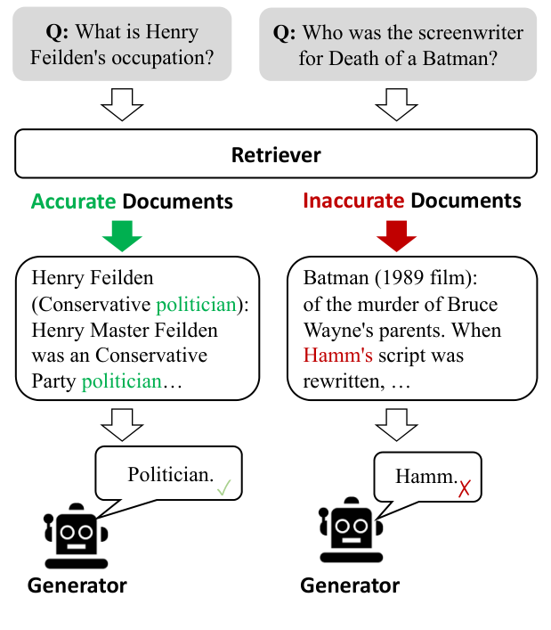
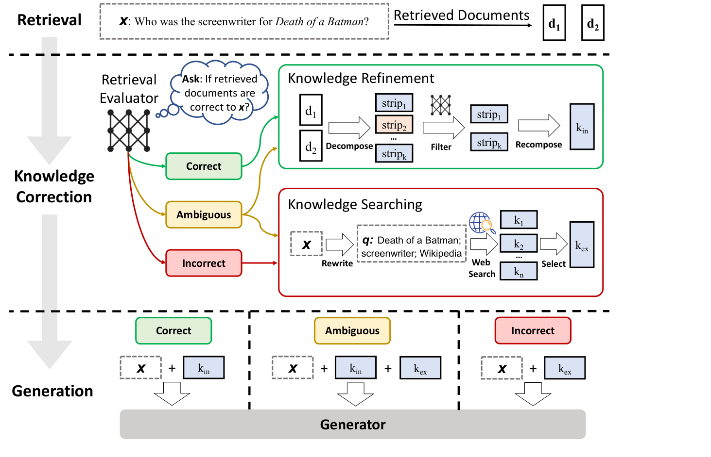
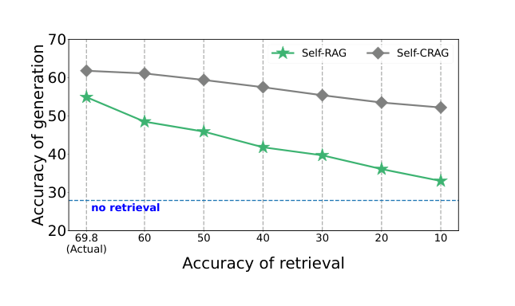

### Перевод статьи

**Корректирующая генерация, дополненная поиском**

***Авторы**: Yan S.-Q.\*, Gu J.-C.\*, Zhu Y., Ling Z.-H. (2024)*

*Национальный инженерно-исследовательский центр обработки речевой и языковой информации, Научно-технический университет Китая (Хэфэй, Китай); факультет компьютерных наук Калифорнийского университета в Лос-Анджелесе; Google DeepMind*

*\* Равный вклад авторов.*

***Издание:** препринт arXiv:2401.15884v3 [cs.CL], 7 октября 2024 г. Перевод выполнен по этой версии.*

**Аннотация (Abstract)**

Большие языковые модели (LLM) неизбежно допускают галлюцинации, поскольку одних лишь заключённых в них параметрических знаний недостаточно, чтобы гарантировать точность генерируемых текстов. Генерация, дополненная поиском (RAG), служит практичным дополнением к LLM, однако она сильно зависит от релевантности извлечённых документов, и возникает вопрос, как поведёт себя модель, если поиск даст ошибочный результат. Для решения этой проблемы предлагается корректирующая генерация, дополненная поиском (**Corrective Retrieval Augmented Generation, CRAG**), которая повышает устойчивость генерации. В частности, разработан легковесный оценщик поиска, который оценивает общее качество документов, извлечённых по запросу, и возвращает степень уверенности; в зависимости от неё запускаются различные действия по извлечению знаний. Поскольку поиск по статичным и ограниченным корпусам может возвращать лишь неоптимальные документы, для расширения результатов поиска используется масштабный веб-поиск. Кроме того, для извлечённых документов разработан алгоритм «декомпозиция — рекомпозиция», позволяющий избирательно сосредоточиться на ключевой информации и отфильтровать нерелевантную. CRAG подключается по принципу plug-and-play и легко сочетается с различными подходами на основе RAG. Эксперименты на четырёх наборах данных, охватывающих задачи генерации коротких ответов и развёрнутых текстов, показывают, что CRAG значительно повышает качество работы подходов на основе RAG.[^1]

**1. Введение (Introduction)**

Большие языковые модели (LLM) привлекают всё больше внимания и демонстрируют выдающиеся способности понимать инструкции и генерировать связные тексты на естественном языке (Brown et al., 2020; Ouyang et al., 2022; Touvron et al., 2023a). Тем не менее LLM неизбежно допускают галлюцинации (Ji et al., 2023): они совершают фактические ошибки (Mallen et al., 2023; Min et al., 2023) и не способны гарантировать точность генерируемых текстов, опираясь только на заключённые в них параметрические знания (Zhang et al., 2023b; Muhlgay et al., 2023).



*Рис. 1. Примеры показывают, что низкокачественный ретривер склонен вносить значительный объём нерелевантной информации, которая мешает генераторам получить точные знания и может вводить их в заблуждение.*

Чтобы включать во входные данные релевантные знания и тем самым дополнять генерацию, в предшествующих исследованиях были предложены методы поиска; характерный пример — генерация, дополненная поиском (RAG) (Lewis et al., 2020). В этом фреймворке входные данные модели дополняются релевантными документами, которые извлекаются из внешнего корпуса знаний и добавляются перед входом (Guu et al., 2020). Хотя RAG служит практичным дополнением к LLM, его результативность зависит от релевантности и точности извлечённых документов (Li et al., 2022; Tan et al., 2022). Сильная зависимость генерации от извлечённых знаний вызывает серьёзные опасения относительно поведения и качества работы модели в ситуациях, когда поиск может завершиться неудачей или вернуть неточные результаты (Shi et al., 2023). Как показано на рис. 1, низкокачественный ретривер склонен вносить значительный объём нерелевантной информации, которая мешает моделям получить точные знания и может вводить их в заблуждение, что приводит к таким проблемам, как галлюцинации (Zhang et al., 2023b). Однако большинство традиционных подходов RAG включают извлечённые документы без разбора, независимо от того, релевантны они или нет (Rony et al., 2022). Кроме того, современные методы, как правило, используют документы целиком в качестве справочных знаний — как при поиске, так и при последующем использовании. Между тем значительная часть текста в извлечённых документах зачастую несущественна для генерации, и опираться на неё в RAG наравне с существенной информацией не следует.

С учётом указанных проблем в данной работе рассматриваются именно те ситуации, когда ретривер возвращает неточные результаты. Предлагается метод корректирующей генерации, дополненной поиском (**Corrective Retrieval-Augmented Generation, CRAG**), который выполняет самокоррекцию результатов ретривера и позволяет эффективнее использовать документы для дополнения генерации. Для оценки общего качества документов, извлечённых по запросу, разработан легковесный оценщик поиска. Он служит ключевым компонентом RAG и способствует информативной генерации, проверяя и оценивая релевантность и надёжность извлечённых документов. Вычисляется степень уверенности, в зависимости от которой запускается одно из действий по извлечению знаний: {Correct, Incorrect, Ambiguous}. Для двух последних действий в качестве стратегического расширения подключается масштабный веб-поиск (Piktus et al., 2021; Komeili et al., 2022), поскольку поиск по статичным и ограниченным корпусам может возвращать лишь неоптимальные с точки зрения охвата и разнообразия документы. Такое дополнение расширяет спектр извлекаемой информации: обширность и динамичность интернета позволяют дополнить и обогатить изначально полученные документы. Кроме того, чтобы исключить содержащийся в извлечённых документах избыточный контекст, бесполезный для RAG, на всех этапах поиска и использования знаний применяется тщательно разработанный алгоритм «декомпозиция — рекомпозиция». Этот алгоритм уточняет извлечённую информацию: оптимизирует выделение ключевых сведений и сводит к минимуму включение несущественных элементов, тем самым повышая эффективность использования извлечённых данных.

CRAG подключается по принципу plug-and-play; чтобы продемонстрировать его адаптируемость к подходам на основе RAG, метод был экспериментально встроен в RAG (Lewis et al., 2020) и Self-RAG (Asai et al., 2024). Результаты на четырёх наборах данных — PopQA (Mallen et al., 2023), Biography (Min et al., 2023), PubHealth (Zhang et al., 2023a) и Arc-Challenge (Bhakthavatsalam et al., 2021) — показывают, что CRAG значительно повышает качество работы стандартного RAG и передового Self-RAG; это свидетельствует о его обобщающей способности как в задачах генерации коротких ответов, так и в задачах генерации развёрнутых текстов. Чтобы другие исследователи могли воспроизвести полученные результаты, весь исходный код будет опубликован позднее.

Таким образом, вклад данной работы состоит в следующем: 1) исследуются ситуации, когда ретривер возвращает неточные результаты, и, насколько известно авторам, впервые предпринята попытка разработать корректирующие стратегии, повышающие устойчивость RAG; 2) предложен подключаемый по принципу plug-and-play метод CRAG, который улучшает способность к автоматической самокоррекции и эффективному использованию извлечённых документов; 3) результаты экспериментов всесторонне подтверждают адаптируемость CRAG к подходам на основе RAG и его обобщающую способность в задачах генерации коротких ответов и развёрнутых текстов.

**2. Обзор родственных работ (Related Work)**

***Галлюцинации LLM (Hallucinations of LLMs).*** Хотя LLM демонстрируют выдающиеся способности понимать инструкции и генерировать связные тексты (Bang et al., 2023; Qin et al., 2023; Zhong et al., 2023), одной из самых серьёзных проблем, с которыми они по-прежнему сталкиваются, остаются галлюцинации. Как показано во многих исследованиях (Tonmoy et al., 2024; Zhang et al., 2023b; Shuster et al., 2021), галлюцинации во многом вызваны тем, что модель задействует устаревшую информацию или неверные знания. На LLM влияют и усугубляют эти проблемы масштабный нерегулируемый сбор обучающих данных, низкая доля высококачественных данных в выборке, несовершенство распределения данных во входном пространстве и многие другие реальные факторы. Очевидно, что недостаток точных и конкретных знаний может приводить к генерации вводящих в заблуждение или даже неверных текстов, а это серьёзно ухудшает пользовательский опыт в большинстве практических приложений.

***Генерация, дополненная поиском (Retrieval-Augmented Generation).*** RAG (Lewis et al., 2020; Guu et al., 2020) считается полезным методом решения указанных проблем: он дополняет входные вопросы генеративных LM извлечёнными документами. Обычно RAG предоставляет дополнительный источник знаний из определённого корпуса, например Википедии, что значительно повышает качество работы LM в различных задачах, особенно в задачах, требующих обширных знаний. Предлагаемые методы, как правило, используют информационный поиск, чтобы предоставить генеративным LLM документы, содержащие релевантные знания. В ранних работах разреженные или плотные ретриверы размещаются перед предобученной языковой моделью, специализирующейся на генерации ответов. Однако перечисленные методы обычно упускают из виду вопрос: *что, если поиск даст ошибочный результат?* Ведь поиск вводится именно для того, чтобы генеративные LM гарантированно получали релевантные и точные знания. Если же извлечённые документы нерелевантны, система поиска может даже усугубить фактические ошибки LM.

***Продвинутые методы RAG (Advanced RAG).*** В последние годы на основе исходного RAG разработано множество продвинутых подходов (Zhang et al., 2024; Kim et al., 2024; Wang et al., 2024; Liu et al., 2024). Для некоторых запросов поиск бывает излишним, а во многих ситуациях ответы без поиска оказываются даже точнее. С учётом этого предложен Self-RAG (Asai et al., 2024), который выполняет поиск знаний избирательно и использует модель-критик, решающую, нужен ли поиск. Yoran et al. (2024) разработали модель логического вывода на естественном языке (NLI), которая выявляет нерелевантный контекст и повышает устойчивость. SAIL (Luo et al., 2023) дообучается на инструкциях, перед которыми вставляются извлечённые документы, а Toolformer (Schick et al., 2023) предобучается вызывать API, например API Википедии. Кроме того, в некоторых задачах генерации длинных текстов внешние знания требуются неоднократно, и необходимо решать, когда выполнять поиск. Jiang et al. (2023) при генерации развёрнутых текстов активно предсказывают дальнейшее содержание и решают, когда и что искать.

По сравнению с наиболее близкими к данной работе недавними исследованиями (Schick et al., 2023; Luo et al., 2023; Asai et al., 2024) следует подчеркнуть одно принципиальное отличие. Эти подходы нацелены на использование поиска как полезного инструмента для дополнения генерации или на определение того, нужен ли поиск, тогда как в данной работе рассматриваются именно ситуации, когда ретривер возвращает неточные результаты. Насколько известно авторам, это первая попытка исследовать и разработать корректирующие стратегии для RAG, повышающие устойчивость генерации.

**3. Постановка задачи (Task Formulation)**

Вслед за предшествующими работами (Lewis et al., 2020; Asai et al., 2024) задача ставится так: по входным данным $\mathcal{X}$ и доступному корпусу, содержащему большое количество документов со знаниями $\mathcal{C} = {\{ d_{1},\ldots,d_{N}\}}$, система должна сгенерировать выход $\mathcal{Y}$. Весь фреймворк обычно делится на ретривер $\mathcal{R}$ и генератор $\mathcal{G}$. Ретривер $\mathcal{R}$ извлекает из корпуса $\mathcal{C}$ top-$\mathcal{K}$ наиболее релевантных входу $\mathcal{X}$ документов $\mathcal{D} = {\{ d_{r_{1}},\ldots,d_{r_{k}}\}}$. На основе входа $\mathcal{X}$ и результатов поиска $\mathcal{D}$ генератор $\mathcal{G}$ формирует выход $\mathcal{Y}$. Этот фреймворк можно формализовать следующим образом:

$${{P\left. (\mathcal{Y} \middle| \mathcal{X}) \right.} = {{P\left. (\mathcal{D} \middle| \mathcal{X}) \right.}P\left. ({\mathcal{Y},\mathcal{D}} \middle| \mathcal{X}) \right.}}. \qquad (1)$$

Из формулы видно, что ретривер и генератор тесно связаны, а устойчивость системы к ошибкам низка. Любой неудачный поиск может привести к неудовлетворительному ответу, какими бы выдающимися способностями ни обладал генератор. Именно повышению устойчивости генерации и посвящена данная работа.



*Рис. 2. Общая схема предлагаемого метода CRAG на этапе инференса. Оценщик поиска оценивает релевантность извлечённых документов входным данным и вычисляет степень уверенности, в зависимости от которой запускается одно из действий по извлечению знаний: {Correct, Incorrect, Ambiguous}.*

**4. CRAG**

**4.1. Общая схема инференса модели (Overview of Model Inference)**

На рис. 2 и в алгоритме 1 представлена общая схема работы CRAG на этапе инференса; метод реализует корректирующие стратегии, повышающие устойчивость генерации. По входному запросу и документам, извлечённым любым ретривером, легковесный оценщик поиска вычисляет оценку релевантности извлечённых документов входному запросу (разд. 4.2). Оценка релевантности переводится в одну из трёх степеней уверенности, после чего запускается соответствующее действие: {Correct, Incorrect, Ambiguous} (разд. 4.3). Если запускается действие Correct, извлечённые документы уточняются — преобразуются в более точные фрагменты знаний. Операция уточнения включает декомпозицию, фильтрацию и рекомпозицию знаний (разд. 4.4). Если запускается действие Incorrect, извлечённые документы отбрасываются, а для коррекции привлекается веб-поиск как дополнительный источник знаний (разд. 4.5). Наконец, если система не может уверенно признать результат поиска ни верным, ни неверным, запускается мягкое, сбалансированное действие Ambiguous, сочетающее оба варианта. После оптимизации результатов поиска можно использовать произвольную генеративную модель.

**4.2. Оценщик поиска (Retrieval Evaluator)**

Прежде чем использовать извлечённые документы, естественно проверить, точны ли они: так можно выявить нерелевантные или вводящие в заблуждение сведения. Точность оценщика поиска, несомненно, играет ключевую роль в общем качестве работы системы, поскольку влияет на результаты последующих этапов. Цель состоит в том, чтобы исправлять извлечённые документы, если они нерелевантны. Оценщик поиска инициализируется моделью T5-large (Raffel et al., 2020) и затем дообучается. Число её параметров значительно меньше, чем у большинства современных LLM (Touvron et al., 2023a; Touvron et al., 2023b; Chowdhery et al., 2023; Anil et al., 2023; Brown et al., 2020; Ouyang et al., 2022; OpenAI, 2023). Чтобы все результаты экспериментов были сопоставимы с Self-RAG (Asai et al., 2024), использовались те же результаты поиска ретривера Contriever (Izacard et al., 2022), которые предоставлены авторами Self-RAG. Сигналы релевантности для дообучения оценщика можно получить из существующих наборов данных. Например, PopQA (Mallen et al., 2023) для каждого вопроса содержит эталонный заголовок статьи Википедии о субъекте вопроса. По нему можно найти текстовый фрагмент, который релевантен не на все 100%, но обладает достаточно высоким качеством. Именно такие фрагменты использовались в качестве сигналов релевантности при дообучении оценщика поиска.[^2] Отрицательные примеры для дообучения отбирались случайным образом из результатов поиска: они довольно близки к входному запросу, но нерелевантны. Подробнее этап дообучения описан в разделе B.3 приложения. Для каждого вопроса обычно извлекается 10 документов. Вопрос конкатенируется с каждым документом в отдельности, и оценщик предсказывает оценку релевантности для каждой пары «вопрос — документ» независимо. Для сравнения ChatGPT с помощью промптов также поручалось определять релевантность результатов поиска, однако эта модель показала худшие результаты (подробнее см. разд. 5.5). На основе вычисленных оценок релевантности выносится итоговое решение о том, верен ли результат поиска, и в соответствии с ним запускается действие. В предлагаемом фреймворке качество поиска оценивается со сравнительно низкими затратами, без обращения к крупным и дорогим LLM. По сравнению с моделью-критиком Self-RAG (Asai et al., 2024), полученной дообучением LLaMA-2 (7B) на инструкциях, оценщик CRAG обладает важным преимуществом — он весьма легковесен (0,77 млрд параметров).

***Алгоритм 1.*** *Инференс CRAG*

Требуется: $E$ (оценщик поиска), $W$ (модуль переформулирования запросов), $G$ (генератор)

**Вход:** $x$ (входной вопрос), $D = {\{{d_{1},d_{2},\ldots,d_{k}}\}}$ (извлечённые документы); **выход:** $y$ (сгенерированный ответ)

1: $score_{i}$ = $E$ оценивает релевантность каждой пары $(x, d_{i})$, $d_{i} \in D$

2: **Confidence** = вычислить и вынести итоговое решение на основе $\{ score_{1}, score_{2}, \ldots, score_{k}\}$

// **Confidence** принимает одно из трёх значений: [CORRECT], [INCORRECT] или [AMBIGUOUS]

3: **если** Confidence == [CORRECT], **то**

4:   Internal_Knowledge = Knowledge_Refine($x$, $D$)

5:   $k$ = Internal_Knowledge

6: **иначе если** Confidence == [INCORRECT], **то**

7:   External_Knowledge = Web_Search($W$ переформулирует $x$ для поиска)

8:   $k$ = External_Knowledge

9: **иначе если** Confidence == [AMBIGUOUS], **то**

10:   Internal_Knowledge = Knowledge_Refine($x$, $D$)

11:   External_Knowledge = Web_Search($W$ переформулирует $x$ для поиска)

12:   $k$ = Internal_Knowledge + External_Knowledge

13: **конец условия**

14: $G$ предсказывает $y$ по $x$ и $k$

**4.3. Запуск действий (Action Trigger)**

Чтобы исправлять нерелевантные документы и при необходимости уточнять целевые документы, действия следует выполнять избирательно. На основе описанной выше оценки уверенности для каждого извлечённого документа предусмотрены три типа действий; какое из них запускается, определяют верхний и нижний пороги. Если оценка уверенности выше верхнего порога, извлечённый документ признаётся верным (Correct), если ниже нижнего — неверным (Incorrect). В остальных случаях выполняется более мягкое, промежуточное действие — Ambiguous. Каждый извлечённый документ обрабатывается отдельно, а результаты затем объединяются.

***Correct.*** Результат поиска считается верным (Correct), если оценка уверенности *хотя бы одного извлечённого документа* превышает верхний порог. Это означает, что среди результатов поиска есть релевантные документы и знания из них предположительно надёжнее и точнее. Однако даже в релевантном документе неизбежно встречаются зашумлённые фрагменты знаний. Чтобы выделить в таком документе наиболее важные фрагменты знаний, дополнительно разработан метод уточнения знаний, подробно описанный в разделе 4.4.

***Incorrect.*** Результат поиска считается неверным (Incorrect), если оценки уверенности *всех извлечённых документов* ниже нижнего порога. Это означает, что все извлечённые документы признаны нерелевантными и бесполезными для генерации. Если знания из результатов поиска признаны неточными, продолжать опираться на них неразумно: это, скорее всего, приведёт к вымышленным фактам. Поэтому для коррекции необходимо искать новые источники знаний. С этой целью вводится веб-поиск в интернете, подробно описанный в разделе 4.5. Это корректирующее действие помогает выйти из затруднительной ситуации, когда надёжных знаний, на которые можно опереться, нет.

***Ambiguous.*** Все остальные случаи относятся к промежуточному действию Ambiguous. Обычно это происходит, когда верность результата поиска трудно определить и оценщик выставляет промежуточную оценку. Поскольку оценщик поиска не уверен в своём решении, оба вида обработанных знаний — полученные в действиях Correct и Incorrect — объединяются и дополняют друг друга. Такая умеренная, мягкая стратегия позволяет существенно повысить устойчивость и надёжность системы и делает фреймворк более гибким, что способствует достижению оптимального качества.

***Обсуждение (Discussion).*** Предварительные эксперименты, в которых использовались только действия Correct и Incorrect, показали, что результативность CRAG сильно зависит от точности оценщика поиска. Вероятная причина — резкое переключение источника знаний для всех входных примеров, независимо от того, насколько уверенно вынесено решение. Введение действия Ambiguous значительно ослабляет зависимость от точности оценщика поиска.

**4.4. Уточнение знаний (Knowledge Refinement)**

Для извлечённого релевантного документа разработан метод уточнения знаний по схеме «декомпозиция — рекомпозиция», позволяющий дополнительно выделить в нём наиболее важные фрагменты знаний (knowledge strips). Чтобы получить детальные результаты поиска, извлечённые результаты разбиваются на внутренние фрагменты. Если извлечённый результат состоит всего из одного-двух предложений, он рассматривается как отдельный фрагмент; в противном случае документ разбивается на более мелкие единицы, которые в зависимости от общей длины обычно включают несколько предложений. Предполагается, что такая единица содержит самостоятельную порцию информации, и фильтрация выполняется по этим сегментам. Затем с помощью оценщика поиска, дообученного в разделе 4.2, вычисляется оценка релевантности каждого фрагмента знаний. На основе этих оценок нерелевантные фрагменты знаний отфильтровываются, а релевантные заново объединяются путём конкатенации в исходном порядке; результат называется внутренними знаниями.

**4.5. Веб-поиск (Web Search)**

Система была бы более интеллектуальной, если бы сама могла определить, что имеющийся корпус знаний не позволяет хорошо решить задачу, и обратиться за помощью к дополнительным внешним знаниям. Если же система, даже понимая, что имеющихся знаний недостаточно, всё равно ограничивается тем же корпусом, она в итоге выдаст лишь вымышленный факт, что и называется галлюцинацией. Поэтому, если все результаты поиска признаны нерелевантными, крайне важно искать дополнительные внешние знания. Система, которая знает, чего она не знает и на что не может ответить, представляется более интеллектуальной, чем система, которая держится за ограниченные знания и не способна искать внешние. Поскольку поиск по статичным и ограниченным корпусам может возвращать лишь неоптимальные с точки зрения охвата и разнообразия документы, в качестве стратегического расширения RAG подключается масштабный веб-поиск (Piktus et al., 2021; Komeili et al., 2022). В частности, ChatGPT переформулирует входные данные в запросы из ключевых слов, имитируя повседневное использование поисковых систем. Промпт для переформулирования приведён в приложении A. В CRAG для получения набора URL-ссылок по каждому запросу используется общедоступный коммерческий API веб-поиска.[^3] Поскольку знания из масштабного веб-поиска могут вносить предвзятость или ненадёжную информацию, предпочтение отдаётся авторитетным и модерируемым веб-страницам, например страницам Википедии, что существенно смягчает эти проблемы. Далее по URL-ссылкам открываются веб-страницы, их содержимое извлекается, и к нему применяется тот же метод уточнения знаний, что и в разделе 4.4; полученные релевантные знания из интернета называются внешними знаниями.

**5. Эксперименты (Experiments)**

Эксперименты проводились для того, чтобы всесторонне продемонстрировать адаптируемость CRAG к подходам на основе RAG и его обобщающую способность в задачах генерации как коротких ответов, так и развёрнутых текстов.

*Таблица 1. Общие результаты на тестовых выборках четырёх наборов данных. Результаты сгруппированы по генерирующим LLM. Полужирным выделены лучшие результаты среди всех методов и LLM, полужирным курсивом (в оригинале — серым полужирным) — лучшие результаты для конкретной LLM. Звёздочкой (\*) отмечены результаты, воспроизведённые авторами; остальные результаты, кроме результатов предлагаемых методов, взяты из оригинальных статей. Прочерк (–) означает, что результат не приводится.*

| Метод | PopQA (точность) | Bio (FactScore) | Pub (точность) | ARC (точность) |
|--------------------------|------------------|-----------------|----------------|----------------|
| *LM, обученные на закрытых данных* |  |  |  |  |
| LLaMA2-c 13B | 20,0 | 55,9 | 49,4 | 38,4 |
| Ret-LLaMA2-c 13B | 51,8 | 79,9 | 52,1 | 37,9 |
| ChatGPT | 29,3 | 71,8 | 70,1 | **75,3** |
| Ret-ChatGPT | 50,8 | – | 54,7 | **75,3** |
| Perplexity.ai | – | 71,2 | – | – |
| *Базовые модели без поиска* |  |  |  |  |
| LLaMA2 7B | 14,7 | 44,5 | 34,2 | 21,8 |
| Alpaca 7B | 23,6 | 45,8 | 49,8 | 45,0 |
| LLaMA2 13B | 14,7 | 53,4 | 29,4 | 29,4 |
| Alpaca 13B | 24,4 | 50,2 | 55,5 | 54,9 |
| CoVE 65B | – | 71,2 | – | – |
| *Базовые модели с поиском* |  |  |  |  |
| LLaMA2 7B | 38,2 | 78,0 | 30,0 | 48,0 |
| Alpaca 7B | 46,7 | 76,6 | 40,2 | 48,0 |
| SAIL | – | – | 69,2 | 48,4 |
| LLaMA2 13B | 45,7 | 77,5 | 30,2 | 26,0 |
| Alpaca 13B | 46,1 | 77,7 | 51,1 | 57,6 |
| *Генератор LLaMA2-hf-7b* |  |  |  |  |
| RAG | 50,5 | 44,9 | 48,9 | 43,4 |
| CRAG | ***54,9*** | 47,7 | ***59,5*** | ***53,7*** |
| Self-RAG\* | 29,0 | 32,2 | 0,7 | 23,9 |
| Self-CRAG | 49,0 | ***69,1*** | 0,6 | 27,9 |
| *Генератор SelfRAG-LLaMA2-7b* |  |  |  |  |
| RAG | 52,8 | 59,2 | 39,0 | 53,2 |
| CRAG | 59,8 | 74,1 | **75,6** | 68,6 |
| Self-RAG | 54,9 | 81,2 | 72,4 | 67,3 |
| Self-CRAG | **61,8** | **86,2** | 74,8 | 67,2 |

**5.1. Задачи, наборы данных и метрики (Tasks, Datasets and Metrics)**

CRAG оценивался на четырёх наборах данных: **PopQA** (Mallen et al., 2023) — генерация *коротких* ответов, **Biography** (Min et al., 2023) — генерация *развёрнутых* текстов, **PubHealth** (Zhang et al., 2023a) — вопросы типа *«верно / неверно»* и **Arc-Challenge** (Bhakthavatsalam et al., 2021) — вопросы *с выбором ответа из нескольких вариантов*. Вслед за предшествующими работами для PopQA, PubHealth и Arc-Challenge в качестве метрики использовалась точность (accuracy), для Biography — FactScore (Min et al., 2023). Подробнее см. раздел B.1 приложения. Метрики взяты те же, что и в предшествующих исследованиях, поскольку предлагаемый метод с ними сопоставим: в нём используются те же результаты поиска, что и в предыдущих работах. Отличие состоит в мотивации: цель — повысить качество поиска, исправляя результаты, которые система признаёт низкокачественными. Это можно сравнить с тем, как RAG дополняет автономные параметрические языковые модели; в данной работе уже сам RAG дополняется корректирующими стратегиями.

**5.2. Базовые модели (Baselines)**

CRAG сравнивался главным образом с подходами без поиска и с поиском; последние, в свою очередь, делятся на стандартный RAG и новейшие продвинутые методы RAG.

***Базовые модели без поиска (Baselines without retrieval).*** Оценивались общедоступные LLM LLaMA2-7B и 13B (Touvron et al., 2023b), дообученные на инструкциях модели Alpaca-7B и 13B (Dubois et al., 2023), а также CoVE 65B (Dhuliawala et al., 2024), в которой для повышения фактической точности генерации LLM применяется итеративный подход (iterative engineering). Включены также проприетарные LLM, например LLaMA2-chat 13B и ChatGPT.

***Стандартный RAG (Standard RAG).*** Оценивался стандартный RAG (Lewis et al., 2020), в котором LM генерирует результат по запросу, перед которым добавлены наиболее релевантные документы, извлечённые тем же ретривером, что и в предлагаемой системе. В качестве LM использовался ряд общедоступных LLM, дообученных на инструкциях: LLaMA2-7B и 13B (Touvron et al., 2023b), Alpaca-7B и 13B (Dubois et al., 2023), а также LLaMA2-7B, дообученная на инструкциях в Self-RAG (Asai et al., 2024).

***Продвинутые методы RAG (Advanced RAG).*** (1) SAIL (Luo et al., 2023): LM дообучается на инструкциях из набора данных Alpaca, перед которыми вставлены наиболее релевантные извлечённые документы. (2) Self-RAG (Asai et al., 2024): LLaMA2 дообучается на данных с инструкциями, содержащих несколько наборов токенов рефлексии, размеченных GPT-4 (OpenAI, 2023). (3) Вслед за Asai et al. (2024) приводятся также результаты базовых моделей с поиском, обученных на закрытых данных: Ret-ChatGPT и Ret-LLaMA-chat, в которых применяется тот же способ дополнения входных данных, а также perplexity.ai — промышленной поисковой системы на основе InstructGPT.

**5.3. Результаты (Results)**

В табл. 1 представлены результаты на четырёх наборах данных. Модель, сочетающая предлагаемый метод со стандартным RAG, названа CRAG, а модель, сочетающая его с Self-RAG, — Self-CRAG. Подробности реализации предлагаемых методов приведены в разделе B.3 приложения. По полученным результатам можно сделать следующие выводы.

*Во-первых, предлагаемый метод значительно повышает качество работы RAG и Self-RAG.* Как видно из табл. 1, с генератором *SelfRAG-LLaMA2-7b* CRAG превзошёл RAG на 7,0% по точности на PopQA, на 14,9% по FactScore на Biography, на 36,6% по точности на PubHealth и на 15,4% по точности на Arc-Challenge, а с генератором *LLaMA2-hf-7b* — на 4,4% по точности на PopQA, на 2,8% по FactScore на Biography и на 10,3% на Arc-Challenge. Self-CRAG превзошёл передовой Self-RAG с генератором *LLaMA2-hf-7b* на 20,0% по точности на PopQA, на 36,9% по FactScore на Biography и на 4,0% по точности на Arc-Challenge, а с генератором *SelfRAG-LLaMA2-7b* — на 6,9% по точности на PopQA, на 5,0% по FactScore на Biography и на 2,4% по точности на PubHealth. Эти результаты демонстрируют адаптируемость CRAG: метод подключается по принципу plug-and-play и может быть встроен в подходы на основе RAG.

*Во-вторых, предлагаемый метод обладает высокой обобщающей способностью в различных задачах генерации.* Представленные в табл. 1 тестовые наборы соответствуют разным практическим сценариям: генерации коротких ответов-сущностей (PopQA), генерации развёрнутых текстов (Biography) и задачам с закрытым набором ответов (PubHealth, Arc-Challenge). Эти результаты подтверждают стабильную результативность CRAG. Универсальность метода в широком спектре задач свидетельствует о его надёжности и обобщающей способности в разнообразных сценариях.

*В-третьих, предлагаемый метод обеспечивает большую гибкость при замене базового генератора LLM.* Как видно из таблицы, CRAG сохранил конкурентоспособное качество при замене базовой LLM *SelfRAG-LLaMA2-7b* на *LLaMA2-hf-7b*, тогда как качество Self-RAG значительно снизилось и на ряде тестовых наборов оказалось даже ниже, чем у стандартного RAG. Причина в том, что Self-RAG необходимо дообучать на инструкциях с данными, размеченными людьми или LLM, чтобы модель научилась при необходимости выдавать специальные токены критики, а обычные LLM этой способностью не обладают. CRAG такой способности не требует. Можно ожидать, что более совершенные LLM, которые появятся в будущем, будут легко сочетаться с CRAG, тогда как для Self-RAG по-прежнему потребуется дополнительное дообучение на инструкциях.

**5.4. Абляционное исследование (Ablation Study)**

*Таблица 2. Абляционное исследование: удаление каждого отдельного действия; точность на наборе данных PopQA.*

| Вариант | LLaMA2-hf-7b | SelfRAG-LLaMA2-7b |
|-------------------------|-----------------------|--------------------------------|
| CRAG | 54,9 | 59,8 |
| без Correct | 53,2 | 58,3 |
| без Incorrect | 54,4 | 59,5 |
| без Ambiguous | 54,0 | 59,0 |
| Self-CRAG | 49,0 | 61,8 |
| без Correct | 43,6 | 59,6 |
| без Incorrect | 47,7 | 60,8 |
| без Ambiguous | 48,1 | 61,5 |

***Влияние каждого запускаемого действия (The impact of each triggered action).*** Чтобы дополнительно проверить результативность действий, запускаемых по решению оценщика поиска, были проведены абляционные тесты с удалением каждого отдельного действия из предлагаемого метода (табл. 2). Изменение качества оценивалось по точности на наборе данных PopQA. При удалении действия Correct или Incorrect оно объединялось с действием Ambiguous, так что примеры, которые изначально запускали Correct или Incorrect, запускали Ambiguous. При удалении действия Ambiguous оставался только один порог, по которому все входные запросы однозначно относились к Correct или Incorrect. Из результатов видно, что качество снижается при удалении любого действия, т. е. каждое действие вносит вклад в повышение устойчивости генерации. Для наглядности были также проведены эксперименты, в которых запускалось только одно действие; их результаты, приведённые в приложении, также подтверждают этот вывод.

*Таблица 3. Абляционное исследование: удаление каждой операции использования знаний; точность на PopQA.*

| Вариант | LLaMA2-hf-7b | SelfRAG-LLaMA2-7b |
|----------------------------------|--------------------|---------------------------|
| CRAG | 54,9 | 59,8 |
| без уточнения | 49,8 | 54,2 |
| без переформулирования | 51,7 | 56,2 |
| без отбора | 50,9 | 58,6 |
| Self-CRAG | 49,0 | 61,8 |
| без уточнения | 35,9 | 52,2 |
| без переформулирования | 37,2 | 58,4 |
| без отбора | 24,9 | 57,9 |

***Влияние каждой операции использования знаний (The impact of each knowledge utilization operation).*** В табл. 3 показано, как меняется качество при удалении ключевой операции использования знаний. Точность на наборе данных PopQA оценивалась при поочерёдном удалении операций использования знаний: уточнения документов, переформулирования поисковых запросов и отбора внешних знаний. Удаление уточнения документов означает, что исходные извлечённые документы напрямую передаются генератору, как в большинстве существующих работ. Удаление переформулирования поисковых запросов означает, что при поиске знаний вопросы не переписываются в запросы из ключевых слов. Наконец, удаление отбора знаний означает, что всё найденное содержимое веб-страниц без отбора используется как внешние знания. Из результатов следует, что качество итоговой системы снижается при удалении любой операции использования знаний, т. е. каждая из них способствует более эффективному использованию знаний.

*Таблица 4. Точность предлагаемого оценщика поиска и ChatGPT при оценке результатов поиска на наборе данных PopQA.*

| Оценщик | Точность |
|----------------------------------------------------------|----------------------|
| Предлагаемый оценщик поиска (на основе T5) | 84,3 |
| ChatGPT | 58,0 |
| ChatGPT-CoT | 62,4 |
| ChatGPT-few-shot | 64,7 |

**5.5. Точность оценщика поиска (Accuracy of the Retrieval Evaluator)**

Качество оценщика поиска во многом определяет качество работы всей системы. Для полученных результатов поиска документов проверялось, насколько точно оценщик поиска определяет их общее качество. Точность оценки результатов поиска на наборе данных PopQA, достигнутая предлагаемым оценщиком и коммерческой LLM ChatGPT, приведена в табл. 4. Промпты для *ChatGPT*, *ChatGPT-CoT* и *ChatGPT-few-shot*, использованные в экспериментах, приведены в приложении A. Результаты показывают, что легковесный оценщик поиска на основе T5 значительно превзошёл сильную модель ChatGPT во всех вариантах.

**5.6. Устойчивость к качеству поиска (Robustness to Retrieval Performance)**



*Рис. 3. Качество генерации Self-RAG и Self-CRAG при различном качестве поиска на наборе данных PopQA с генератором SelfRAG-LLaMA-7b. Нижняя горизонтальная линия показывает качество генератора без поиска.*

Чтобы дополнительно проверить устойчивость предлагаемого метода к качеству поиска, было исследовано, как меняется качество генерации при различном качестве поиска. Для имитации низкокачественного ретривера часть точных результатов поиска намеренно удалялась случайным образом, после чего оценивалось изменение качества. На рис. 3 показано изменение качества Self-RAG и Self-CRAG на наборе данных PopQA. Видно, что с ухудшением поиска качество генерации Self-RAG и Self-CRAG снижается, т. е. генератор сильно зависит от качества ретривера. Кроме того, при ухудшении поиска качество генерации Self-CRAG снижается слабее, чем у Self-RAG. Эти результаты указывают на превосходство Self-CRAG над Self-RAG с точки зрения устойчивости к качеству поиска.

*Таблица 5. Сравнение CRAG и Self-CRAG с RAG и Self-RAG при одинаковых входных данных; точность.*

| Метод | LLaMA2-hf-7b | SelfRAG-LLaMA2-7b |
|----------------------------------|--------------------|---------------------------|
| *PopQA* |  |  |
| CRAG | 54,9 | 59,8 |
| RAG | 50,5 | 52,8 |
| RAG с веб-поиском | 52,2 | 53,8 |
| Self-CRAG | 49,0 | 61,8 |
| Self-RAG | 29,0 | 54,9 |
| Self-RAG с веб-поиском | 24,9 | 57,9 |

**5.7. Постоянное дополнение знаниями из веб-поиска (Consistent Supplementation of Web Search Knowledge)**

В данной работе подчёркивается необходимость обогащать извлечённый контекст дополнительной информацией, если исходные результаты поиска нерелевантны и ненадёжны. Вместе с тем важно убедиться, что основной прирост качества в предлагаемом методе обусловлен механизмом самокоррекции, а не только дополнительной информацией, полученной с помощью веб-поиска. Чтобы дополнительно продемонстрировать результативность предлагаемого механизма самокоррекции, RAG и Self-RAG во всех случаях дополнялись знаниями из веб-поиска: так им был доступен тот же объём извлечённых знаний. Результаты в табл. 5 показывают, что постоянное дополнение RAG или Self-RAG знаниями из веб-поиска в большинстве случаев повышает качество (за исключением Self-RAG с веб-поиском на исходной модели LLaMA2), хотя прирост остаётся ограниченным. При этом дополнение RAG или Self-RAG предлагаемым механизмом самокоррекции во всех случаях дало значительно лучшие результаты, чем постоянное дополнение знаниями из веб-поиска. Это подтверждает, что наблюдаемые улучшения обусловлены прежде всего предлагаемым механизмом самокоррекции.

*Таблица 6. Оценка вычислительных затрат RAG, CRAG, Self-CRAG и Self-RAG: число FLOPs на токен на GPU и время выполнения на один пример. Верхняя граница для Self-CRAG ниже, поскольку на вход подаются только три текстовых фрагмента (содержимое для случаев correct, incorrect и ambiguous). Все данные в таблице — лишь приблизительная оценка этапа генерации; этапы поиска и обработки данных не учитываются.*

| Метод | TFLOPs на токен | Время выполнения, с |
|------------------|----------------------------|----------------------------------|
| RAG | 26,5 | 0,363 |
| CRAG | 27,2 | 0,512 |
| Self-RAG | 26,5–132,4 | 0,741 |
| Self-CRAG | 27,2–80,2 | 0,908 |

**5.8. Анализ вычислительных затрат (Computational Overhead Analysis)**

Чтобы показать, что предлагаемый механизм самокоррекции является легковесным решением, подключаемым по принципу plug-and-play к различным фреймворкам на основе RAG, были измерены вычислительные затраты. Использовались формулы прогнозирования FLOPs из работы Narayanan et al. (2021); результаты — прогнозируемое число FLOPs на токен на GPU — приведены в табл. 6. Self-RAG адаптивно меняет стратегию генерации в зависимости от входных данных, поэтому его вычислительные затраты невозможно определить точно и для него приводится оценочный диапазон. Кроме того, на PopQA были проведены эксперименты для оценки среднего фактического времени выполнения на один пример (см. табл. 6). Результаты показывают, что механизм самокоррекции требует лишь умеренных дополнительных вычислительных затрат и при этом значительно повышает качество, что подтверждает его легковесность.

**6. Заключение и ограничения (Conclusion & Limitation)**

В данной работе рассматривается проблема, с которой сталкиваются подходы на основе RAG, если поиск даёт ошибочный результат и генеративные LM получают неточные и вводящие в заблуждение знания. Для повышения устойчивости генерации предложена корректирующая генерация, дополненная поиском. Её основа — легковесный оценщик поиска, который оценивает результаты поиска и избирательно запускает одно из трёх действий по извлечению знаний. Благодаря дополнительному использованию веб-поиска и оптимизированному использованию знаний CRAG значительно улучшает способность к автоматической самокоррекции и эффективному использованию извлечённых документов. Эксперименты всесторонне подтверждают адаптируемость метода к подходам на основе RAG и его обобщающую способность в задачах генерации коротких ответов и развёрнутых текстов. Хотя предложенный метод улучшает фреймворк RAG прежде всего с корректирующей точки зрения и CRAG легко сочетается с различными подходами на основе RAG, дообучение внешнего оценщика поиска остаётся неизбежным. Устранение этого внешнего оценщика и наделение LLM более развитыми способностями к оценке результатов поиска — направление дальнейших исследований.

[^1]: Код доступен по адресу: <https://github.com/HuskyInSalt/CRAG>.

[^2]: <https://huggingface.co/datasets/akariasai/PopQA>

[^3]: В данной работе для поиска используется Google Search API.

### 30 слов и выражений из текста статьи

1. **Hallucinations**: галлюцинации, т. е. генерация правдоподобных, но не соответствующих фактам сведений (*"Large language models (LLMs) inevitably exhibit hallucinations"*).
2. **Parametric knowledge**: параметрические знания, т. е. знания, хранящиеся в параметрах модели (*"cannot be secured solely by the parametric knowledge they encapsulate"*).
3. **Retrieval evaluator**: оценщик поиска (модуль, оценивающий релевантность извлечённых документов) (*"a lightweight retrieval evaluator is designed to assess the overall quality of retrieved documents"*).
4. **Confidence degree**: степень уверенности (*"returning a confidence degree based on which different knowledge retrieval actions can be triggered"*).
5. **Large-scale web searches**: масштабный веб-поиск (*"large-scale web searches are utilized as an extension for augmenting the retrieval results"*).
6. **Decompose-then-recompose algorithm**: алгоритм «декомпозиция — рекомпозиция» (документ разбивается на части, а релевантные части снова объединяются) (*"a decompose-then-recompose algorithm is designed for retrieved documents"*).
7. **Plug-and-play**: подключаемый по принципу plug-and-play, т. е. встраиваемый в готовую систему без её переделки (*"CRAG is plug-and-play and can be seamlessly coupled with various RAG-based approaches"*).
8. **Short- and long-form generation tasks**: задачи генерации коротких ответов и развёрнутых текстов (*"Experiments on four datasets covering short- and long-form generation tasks"*).
9. **Retrieval-augmented generation**: генерация, дополненная поиском (RAG) (*"as exemplified by retrieval-augmented generation (RAG)"*).
10. **External knowledge corpus**: внешний корпус знаний (*"retrieved from an external knowledge corpus"*).
11. **Corrective strategies**: корректирующие стратегии (*"makes the first attempt to design corrective strategies"*).
12. **Adaptability**: адаптируемость (применимость к разным подходам) (*"for demonstrating its adaptability to RAG-based approaches"*).
13. **Generalizability**: обобщающая способность (*"demonstrating its generalizability across both short- and long-form generation tasks"*).
14. **Knowledge-intensive**: требующий обширных знаний (о задачах) (*"especially in the knowledge-intensive ones"*).
15. **Sparse or dense retrievers**: разреженные или плотные ретриверы (поиск по совпадению слов или по векторным представлениям) (*"Earlier studies adopt either sparse or dense retrievers"*).
16. **Critic model**: модель-критик (*"introduce a critic model to decide whether to retrieve"*).
17. **NLI model**: модель логического вывода на естественном языке (natural language inference) (*"designed an NLI model to identify the irrelevant context"*).
18. **Low risk tolerance**: низкая устойчивость к ошибкам (*"exhibiting low risk tolerance"*).
19. **Knowledge strips**: фрагменты знаний (небольшие части документа, обычно из нескольких предложений) (*"the retrieved documents will be refined into more precise knowledge strips"*).
20. **Golden subject wiki title**: эталонный заголовок статьи Википедии о субъекте вопроса (*"provides the golden subject wiki title from wikipedia for each question"*).
21. **Relevance signals**: сигналы релевантности (данные, указывающие, какой документ релевантен) (*"The relevance signals for fine-tuning the evaluator can be collected from the existing datasets"*).
22. **Negative samples**: отрицательные примеры (*"the negative samples for fine-tuning were all randomly sampled from the retrieval results"*).
23. **Relevance score**: оценка релевантности (*"the evaluator predicts the relevance score for each question-document pair individually"*).
24. **Lightweight**: легковесный (с небольшим числом параметров) (*"the evaluator designed in CRAG demonstrates the advantages of being quite lightweight"*).
25. **Upper and lower thresholds**: верхний и нижний пороги (*"triggered accordingly where the upper and lower thresholds are set"*).
26. **Confidence score**: оценка уверенности (*"If the confidence score is higher than the upper threshold"*).
27. **Fabricated facts**: вымышленные факты (*"which is likely to result in fabricated facts"*).
28. **Knowledge refinement**: уточнение знаний (*"a decompose-then-recompose knowledge refinement method is designed"*).
29. **Internal knowledge**: внутренние знания (уточнённые знания из извлечённых документов) (*"recomposed via concatenation in order, namely internal knowledge"*).
30. **External knowledge**: внешние знания (уточнённые знания из веб-поиска) (*"to derive the relevant web knowledge, namely external knowledge"*).
31. **Instruction-tuned LLMs**: LLM, дообученные на инструкциях (*"Here we adopted several public instruction-tuned LLMs"*).
32. **Closed-set tasks**: задачи с закрытым набором ответов (*"and closed-set tasks (PubHealth, Arc-Challenge)"*).
33. **Ablation tests**: абляционные тесты (эксперименты с удалением отдельных компонентов метода) (*"ablation tests for removing each single action in the proposed method were conducted"*).
34. **Search query rewriting**: переформулирование поисковых запросов (*"removing search query rewriting denoted that questions were not rewritten"*).
35. **Robustness**: устойчивость (*"on enhancing the robustness to retrieval performance"*).
36. **Self-correction mechanism**: механизм самокоррекции (*"the primary improvements in our method stem from the self-correction mechanism"*).
37. **Computational overhead**: вычислительные затраты (дополнительная вычислительная нагрузка) (*"the self-correction mechanism incurs only modest computational overhead"*).
38. **Execution time per instance**: время выполнения на один пример (*"to assess the average execution time per instance in practice"*).

### TASK 1

#### Step 1: Navigating and positioning a text using publication details

- **Name of the journal**: not applicable. The article is a preprint published on arXiv, the open repository of scientific papers (arXiv:2401.15884, section Computation and Language, cs.CL). arXiv lists no journal reference for it, and no peer-reviewed version could be found. The translation follows version 3 of the preprint (arXiv:2401.15884v3).
- **The volume number of the journal**: not applicable, as arXiv preprints are not published in volumes.
- **The issue number of the volume**: not applicable, as arXiv preprints are not published in issues.
- **The year of publication**: 2024 (version 1 appeared on 29 January 2024, version 3 on 7 October 2024).
- **The first and the last page numbers of the article**: not applicable, as a preprint has no page numbers in a journal; version 3 has 16 pages, and the main text takes pages 1–10.
- **The title of the article**: Corrective Retrieval Augmented Generation.
- **The names (surnames and initials) of the authors**: Yan, S.-Q., Gu, J.-C., Zhu, Y., and Ling, Z.-H.

#### Step 2: Genre, audience, and purpose

##### 1. What type of article is this?

- It is a research article. The authors propose a new method, Corrective Retrieval Augmented Generation (CRAG), combine it with two existing approaches, test it on four datasets against many baselines, and report quantitative results, ablation studies and analyses of robustness and computational cost. The structure is close to IMRaD: Introduction, Related Work, Task Formulation, the method (Section 4), Experiments with results and analysis, and Conclusion & Limitation.
- It is a preprint, so it has not passed formal peer review in this version. The authors have revised it twice; version 3 updates the results, adds more analysis and fixes typos.

##### 2. Who do you think it is written for?

- Researchers, lecturers and professors working in natural language processing and machine learning, and graduate students who study large language models and retrieval-augmented generation.
- Experts rather than novices. The authors expect the reader to know how retrieval-augmented generation and Self-RAG work and what instruction tuning, T5, LLaMA2, Contriever, FactScore and FLOPs are. These terms are used without explanation.
- An international audience. The paper is written in English, is freely available on arXiv, and uses international benchmarks and widely used models.

##### 3. Questions based on the title:

- **Why has the article been written?** Retrieval-augmented generation depends on the quality of the retrieved documents, but most methods use these documents without checking them. If the retriever returns irrelevant documents, the model can produce wrong facts. The authors wrote the article to study this case and to propose a way to correct poor retrieval results before generation.
- **What is the object of the article?** Retrieval-augmented language models, and in particular the step between retrieval and generation, where the relevance of the retrieved documents is judged and the knowledge from them is selected.
- **What does the article review / investigate?** It investigates whether a lightweight retrieval evaluator that triggers corrective actions (refining the retrieved documents, searching the web, or combining both) makes standard RAG and Self-RAG more robust and accurate on short-form and long-form generation tasks.

#### Step 3: Study the whole text and answer the questions

##### a. What is the background and aim of the investigation?

- **Background**: Large language models hallucinate because their parametric knowledge cannot guarantee that the generated text is accurate. Retrieval-augmented generation (RAG) adds documents from an external corpus to the input, but its results depend on the relevance and accuracy of these documents. Figure 1 of the paper shows the problem: for the question "Who was the screenwriter for Death of a Batman?" the retriever returns a document about the 1989 film Batman, and the generator answers "Hamm", which is wrong. Most RAG methods add retrieved documents without checking their relevance and use whole documents, although much of their text is not needed for the answer. Related advanced methods, such as Self-RAG, SAIL and Toolformer, decide whether and how to retrieve, but they do not study what happens when the retrieval itself is wrong.
- **Aim**: To design corrective strategies for RAG, the first such attempt according to the authors. The method should check the quality of the retrieved documents, correct poor retrieval results and use the useful parts of the documents more efficiently. It should also be plug-and-play, so that it can be added to different RAG-based approaches.

##### b. What was done in the investigation?

- The authors built a retrieval evaluator by fine-tuning T5-large, a model with 0.77B parameters. As positive examples they used passages found through the golden Wikipedia title that PopQA provides for each question; negative examples were randomly sampled from the retrieval results. About 10 documents are retrieved for each question (the same Contriever results that Self-RAG used), and the evaluator scores each question–document pair separately, from −1 to 1.
- They defined three actions with an upper and a lower threshold. The action is Correct if at least one document scores above the upper threshold, and Incorrect if all documents score below the lower threshold; in all other cases it is Ambiguous. The thresholds were set empirically for each dataset, for example (0.59, −0.99) for PopQA.
- For Correct, a decompose-then-recompose algorithm splits the documents into knowledge strips of one or a few sentences, scores the strips with the same evaluator, removes the irrelevant ones and joins the rest into internal knowledge. For Incorrect, ChatGPT rewrites the question into keyword queries, the Google Search API returns links to web pages (Wikipedia pages are preferred), and the same refinement method extracts external knowledge from them. For Ambiguous, internal and external knowledge are combined.
- The method was combined with standard RAG (the result is called CRAG) and inserted into Self-RAG (called Self-CRAG). Two generators were used: LLaMA2-hf-7b and SelfRAG-LLaMA2-7b, the model fine-tuned by the authors of Self-RAG.
- The systems were tested on four datasets: PopQA (1,399 rare-entity questions, short-form generation, accuracy), Biography (long-form generation, FactScore), PubHealth (true-or-false questions, accuracy) and Arc-Challenge (multiple-choice questions, accuracy). Baselines included LLaMA2, Alpaca, CoVE, LLaMA2-chat and ChatGPT without retrieval, standard RAG with several instruction-tuned LLMs, and advanced RAG methods: SAIL, Self-RAG, Ret-ChatGPT, Ret-LLaMA-chat and perplexity.ai.
- The authors also ran ablation studies on PopQA, removing each action and each knowledge utilization operation (refinement, query rewriting and selection of web knowledge). They compared the accuracy of their evaluator with ChatGPT prompted in three ways, removed accurate retrieval results at random to imitate a weak retriever, gave RAG and Self-RAG the same web search knowledge, and estimated the computational overhead in FLOPs per token and execution time per instance. The experiments ran on NVIDIA A800 80GB GPUs.

##### c. What was found/discovered?

- With the SelfRAG-LLaMA2-7b generator, CRAG outperformed standard RAG on all four datasets: 59.8 against 52.8 on PopQA, 74.1 against 59.2 on Biography, 75.6 against 39.0 on PubHealth and 68.6 against 53.2 on Arc-Challenge. Self-CRAG outperformed Self-RAG on PopQA (61.8 against 54.9), Biography (86.2 against 81.2) and PubHealth (74.8 against 72.4), and scored about the same on Arc-Challenge (67.2 against 67.3).
- With LLaMA2-hf-7b, CRAG also improved on standard RAG, for example from 50.5 to 54.9 on PopQA. Self-CRAG improved on Self-RAG from 29.0 to 49.0 on PopQA and from 32.2 to 69.1 on Biography. On PubHealth both systems scored below 1 point with this generator; according to the appendix, LLaMA2-hf-7b often failed to answer "True" or "False".
- The best results in Table 1 belong to the proposed methods on three datasets: Self-CRAG on PopQA (61.8) and Biography (86.2), and CRAG on PubHealth (75.6). On Arc-Challenge, ChatGPT with and without retrieval remained the best (75.3).
- Every component mattered. Removing any of the three actions lowered PopQA accuracy, for example from 54.9 to 53.2 without Correct for CRAG with LLaMA2-hf-7b. Removing knowledge selection lowered the accuracy of Self-CRAG with this generator from 49.0 to 24.9.
- The T5-based evaluator judged retrieval results on PopQA with 84.3 percent accuracy, against 58.0 for ChatGPT, 62.4 for ChatGPT with Chain-of-Thought and 64.7 for few-shot ChatGPT.
- When retrieval accuracy was lowered step by step from the actual 69.8 percent to 10 percent, the generation accuracy of both systems fell, but Self-CRAG lost less than Self-RAG.
- Adding web search results to RAG and Self-RAG gave smaller gains than CRAG: for example, 53.8 for RAG with web search against 59.8 for CRAG with SelfRAG-LLaMA2-7b.
- The overhead was small: 27.2 TFLOPs per token for CRAG against 26.5 for RAG, and 0.512 against 0.363 seconds per instance for the generation stage.

##### d. What do the Results mean?

- Checking the retrieved documents and correcting poor retrieval makes retrieval-augmented generation more robust. The method helps on short-form, long-form and closed-set tasks, and it can be added to different RAG approaches.
- The gains come mainly from the self-correction mechanism. Giving the baselines the same web search knowledge did not reach the results of CRAG and Self-CRAG.
- CRAG does not require the generator to produce special tokens, so it works with an ordinary LLM. Self-RAG, in contrast, lost much of its accuracy when its fine-tuned model was replaced with LLaMA2-hf-7b. The authors therefore expect future LLMs to be easy to combine with CRAG.
- A small fine-tuned evaluator can judge retrieval quality better than a large general model such as ChatGPT, at a low computational cost.
- The authors name one main limitation: CRAG needs an external retrieval evaluator that must be fine-tuned. In future work they plan to remove this evaluator and give LLMs better retrieval evaluation abilities. Other limits are visible in the paper: the thresholds are set empirically for each dataset, the evaluator is trained on PopQA data and transferred to the other datasets, web search may bring biased or unreliable information (the authors reduce this risk by preferring Wikipedia), and the cost estimates do not include the retrieval and data-processing stages.

##### e. What literature sources are referenced in the paper?

- The reference list contains 41 sources published between 2020 and 2024; 27 of them appeared in 2023–2024. Many are arXiv preprints or papers from NLP and machine learning conferences.
- Large language models and their hallucinations: Brown et al. (2020), Ouyang et al. (2022), Touvron et al. (2023a, 2023b), Chowdhery et al. (2023), Anil et al. (2023) and OpenAI (2023); studies and surveys of hallucination and factual errors by Ji et al. (2023), Zhang et al. (2023b), Tonmoy et al. (2024), Shuster et al. (2021), Mallen et al. (2023), Min et al. (2023) and Muhlgay et al. (2023); and evaluations of ChatGPT by Bang et al. (2023), Qin et al. (2023) and Zhong et al. (2023).
- Foundations of retrieval-augmented generation and its weaknesses: Lewis et al. (2020), Guu et al. (2020), the survey by Li et al. (2022), Tan et al. (2022) (co-authored by J.-C. Gu and Z.-H. Ling), Rony et al. (2022), and Shi et al. (2023), who show that LLMs are easily distracted by irrelevant context.
- Advanced RAG methods compared with CRAG: Self-RAG (Asai et al., 2024), which provides the retrieval results, a generator and the main baseline, SAIL (Luo et al., 2023), Toolformer (Schick et al., 2023), active retrieval by Jiang et al. (2023), the NLI-based method of Yoran et al. (2024), and recent work by Zhang et al. (2024), Kim et al. (2024), Wang et al. (2024) and Liu et al. (2024).
- Web search as a knowledge source: Piktus et al. (2021) and Komeili et al. (2022).
- Models, datasets, metrics and tools used in the experiments: T5 (Raffel et al., 2020), Contriever (Izacard et al., 2022), Alpaca (Dubois et al., 2023), CoVE (Dhuliawala et al., 2024), PopQA (Mallen et al., 2023), Biography and FactScore (Min et al., 2023), PubHealth (Zhang et al., 2023a), Arc-Challenge (Bhakthavatsalam et al., 2021), and the FLOPs formulas of Narayanan et al. (2021).
- Together, these sources explain why LLMs need retrieval, show why uncorrected retrieval can mislead them, and provide the baselines, datasets and metrics for the evaluation of CRAG.

### TASK 2: Annotation (Humanized / De-AI Version)

**Title:** Annotation of the research article *"Corrective Retrieval Augmented Generation"*

The article I'm going to give a review of is taken from arXiv, a free online archive of research preprints (arXiv:2401.15884, version 3, 2024). The headline of the article is *"Corrective Retrieval Augmented Generation"*. It is written by S.-Q. Yan, J.-C. Gu, Y. Zhu and Z.-H. Ling.

The topic of the article is retrieval-augmented generation, where a language model answers using documents found by a search. The key issue of the article is what such a system should do when the search brings back irrelevant or wrong documents. The article under discussion is devoted to the problem of hallucinations caused by bad retrieval: most RAG methods use the documents they find without checking them and pass them on whole. The article under discussion may be divided into several logically connected parts which are the introduction, related work, the task formulation, the method, the experiments with their analysis, and the conclusion with limitations.

The author starts by telling the reader that a weak retriever can bring in irrelevant information and mislead the generator. At the beginning of the article the author describes a small retrieval evaluator built on T5-large. It scores every retrieved document and chooses one of three actions: Correct, Incorrect or Ambiguous. Then the author explains what happens next: useful documents are cut into short knowledge strips, and the irrelevant ones are dropped. Web search replaces bad results and adds to doubtful ones. After that the author points out the results. With the SelfRAG-LLaMA2-7b generator, CRAG raises the accuracy of standard RAG from 52.8 to 59.8 on PopQA and from 39.0 to 75.6 on PubHealth, and Self-CRAG gets a FactScore of 86.2 on Biography. The author also touches upon ablation studies and shows that the evaluator is better than ChatGPT at judging search results (84.3 against 58.0 accuracy), while CRAG adds little computing cost. In conclusion the author makes it clear that CRAG is plug-and-play and works with different RAG systems and generators. The author concludes by saying that the method still needs a separately trained evaluator, and removing it is left for future work.

### TASK 3: Oral Presentation (Humanized / De-AI Version)

**Speaker:** Dmitry Dolzhikov  
**Topic:** CRAG: Checking and Correcting Retrieved Documents in Retrieval-Augmented Generation  
**Estimated Speech Duration:** 5–7 minutes (~825 words)  
**Visual aids:** Figure 1 of the article (`articles/article4_figures/figure1.png`) for the example of poor retrieval, Figure 2 (`articles/article4_figures/figure2.png`) for the overview of CRAG, Tables 1 and 4 of the article for the main results and the accuracy of the evaluator, Figure 3 (`articles/article4_figures/figure3.png`) for robustness to poor retrieval.

```text
Timing Overview:
- 1. Opening: ~1.2 min (160 words)
- 2. Body:    ~4.1 min (539 words)
- 3. Closing: ~1.0 min (126 words)
Total: ~6.3 minutes at 130 words/min, 5.9–6.9 minutes at 140–120 words/min (825 words)
```

#### 1. Opening (~1.2 minutes)

Good afternoon, ladies and gentlemen. Thank you all for coming today.

My name is Dmitry Dolzhikov. Today I am going to talk about the article "Corrective Retrieval Augmented Generation", or CRAG for short. It comes from researchers at the University of Science and Technology of China, the University of California, Los Angeles, and Google DeepMind, and it was published as a preprint on arXiv in 2024.

Large language models often hallucinate. They write fluent answers with wrong facts in them. One common fix is retrieval-augmented generation, or RAG: the system looks up documents and hands them to the model along with the question. But what if the search brings back the wrong documents? Most RAG systems just trust them.

To start with, I'll describe the problem of poor retrieval. Then I'll mention how CRAG checks and fixes the documents it gets. Next, I'll discuss the experiments and the results. Finally, I'll summarize what this means for reliable question answering systems.

#### 2. Body (~4.1 minutes)

Let's begin by looking at the problem. In the authors' example, the question is: "Who was the screenwriter for Death of a Batman?" The search returns a document about the 1989 film Batman, which mentions a script by someone called Hamm. The model believes it and answers "Hamm", which is wrong. So a weak retriever can actively mislead the model.

Where does that lead us? The authors put a small checker, the retrieval evaluator, between the search step and the generator. It's built on the T5-large model and has only about seven hundred and seventy million parameters. The evaluator gives every retrieved document a relevance score, and the scores decide what happens next. If at least one document scores above an upper threshold, the retrieval counts as Correct. If every document falls below a lower threshold, it counts as Incorrect. Anything in between is Ambiguous.

Well, I've told you about the evaluator. Now we'll move on to the three actions. For a Correct result, the system cuts the documents into short knowledge strips of one or a few sentences, scores each strip, drops the irrelevant ones and puts the rest back together. For an Incorrect result, the documents are thrown away. ChatGPT turns the question into a short keyword query, and the system searches the web, preferring Wikipedia pages. For an Ambiguous result, the system uses both kinds of knowledge. CRAG only changes what the generator receives, so it can be added to an existing system. The authors call this plug-and-play.

Let's consider this in more detail. The authors combined their method with standard RAG, which gives CRAG, and with Self-RAG, which gives Self-CRAG. They tested both on four datasets: PopQA, with short questions about rare entities; Biography, with long texts about people; PubHealth, with true-or-false health claims; and ARC-Challenge, with multiple-choice science questions.

Let me turn now to the results. What does this mean for accuracy? To give you an example, take the Self-RAG version of Llama 2 as the generator. With it, CRAG raised the accuracy of standard RAG on PopQA from about fifty-three to almost sixty percent, and on PubHealth from thirty-nine to about seventy-six percent. On biographies, Self-CRAG reached a FactScore of eighty-six, while Self-RAG reached eighty-one.

A good example of this is the evaluator itself. On PopQA it judged the retrieved documents correctly about eighty-four percent of the time. ChatGPT managed only fifty-eight percent. So here a small model trained for one job did better than a large general one.

The method also works with an ordinary generator. When the authors swapped the special Self-RAG model for the original Llama 2, Self-RAG's accuracy on PopQA fell from fifty-five to twenty-nine percent. CRAG, with the same original model, still got fifty-five percent.

The authors also checked where the gain comes from. Giving standard RAG and Self-RAG the same web search results helped only a little. Taking away any of the three actions, or any of the knowledge processing steps, lowered the accuracy. And when the authors made retrieval worse on purpose, Self-CRAG lost much less accuracy than Self-RAG. The extra cost is small: generating an answer took about zero point five seconds per question with CRAG, against zero point three six seconds for standard RAG.

#### 3. Closing (~1.0 minute)

In conclusion, let me sum up the main findings. First, CRAG checks the retrieved documents with a small evaluator and picks one of three actions: clean up the documents, search the web, or do both. Second, it improves both standard RAG and Self-RAG on short answers, long texts and questions with fixed answer choices, and it works with different generators. Third, it still needs a separately trained evaluator, and the authors plan to remove that dependence in future work.

If you take just one thing from this talk, take this: a system that checks its sources before it answers is more reliable than one that trusts every document it finds.

Many thanks for your attention. Now I'll be glad to answer any questions you may have.
